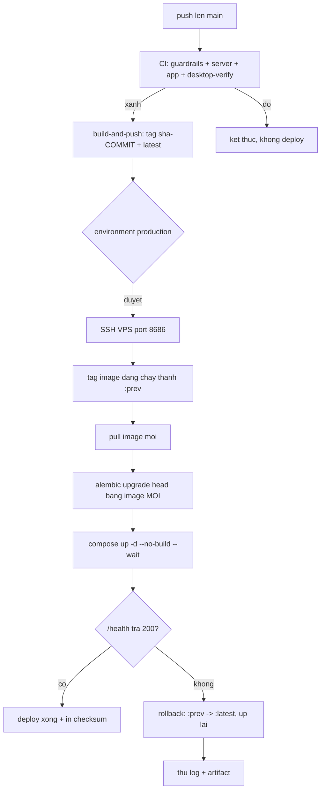

# Deployment (CD) — image lên VPS bằng GitHub Actions

Cập nhật: 2026-11-10. Workflow: [`.github/workflows/cd.yml`](../.github/workflows/cd.yml).
Script chạy trên VPS: [`.github/scripts/vps-deploy.sh`](../.github/scripts/vps-deploy.sh).

## 1. Nguyên tắc

**CI là cổng, CD chỉ chở hàng.** `cd.yml` chạy bằng `workflow_run` sau khi CI
xong, nên một commit đỏ không bao giờ tới được VPS. Không đặt job build vào
`ci.yml` để chạy song song với test: làm vậy sẽ push image cho một commit mà
test có thể còn đỏ, và phải sửa chính file CI đang gác mọi thứ.

**VPS giữ nguyên cấu hình của nó.** Máy đích dùng compose sửa tay
(`.env` ở gốc, `Caddyfile` chỉ tồn tại trên VPS, không có trong repo). CD
**không** copy `docker-compose.yml`, `.env` hay `Caddyfile` xuống máy đích —
script chạy qua stdin của `ssh`, không ghi file nào vào thư mục dự án. Bước cuối
in `sha256sum` của bốn file đó để chứng minh không byte nào bị đổi.

**`:prev` là đường lui duy nhất.** Trước khi pull, image đang chạy được tag
thành `:prev`; health fail thì `:latest` được trỏ lại `:prev`. Vì vậy không
bao giờ `docker rm` container hay `docker image prune`: xoá `:prev` là xoá luôn
đường rollback.

## 2. Luồng



Dockerfile chạy thẳng `uvicorn`, **không** có entrypoint migration. Vì thế
`alembic upgrade head` là bước riêng, dùng image mới, và đứng **trước** lúc
container được thay — code mới không bao giờ phục vụ request trên schema cũ.

## 3. Secrets và variables (một lần)

Settings → Secrets and variables → Actions.

| Loại | Tên | Giá trị |
|---|---|---|
| Secret | `DOCKERHUB_USERNAME` | `anhvietanh1123` |
| Secret | `DOCKERHUB_TOKEN` | access token Read/Write (không dùng mật khẩu) |
| Secret | `VPS_SSH_KEY` | private key ed25519, toàn bộ nội dung kể cả dòng BEGIN/END |
| Secret | `VPS_KNOWN_HOSTS` | output của `ssh-keyscan -p 8686 <host>` |
| Variable | `VPS_HOST` | IP VPS |
| Variable | `VPS_PORT` | `8686` |
| Variable | `VPS_USER` | `root` |
| Variable | `VPS_PROJECT_DIR` | `/root/srs-review-ai` |
| Variable | `IMAGE_NAME` | `anhvietanh1123/srs-review-ai` |
| Variable | `VPS_SERVICE` (tuỳ chọn) | tên service trong compose, mặc định `server` |
| Variable | `VPS_HEALTH_PORT` (tuỳ chọn) | cổng trong container, mặc định `8000` |

Không giá trị nào nằm literal trong workflow. `tools/check_guardrails.py` quét
`.github/workflows/*.yml` và sẽ đỏ nếu ai đó hard-code bí mật vào file.

### Chuẩn bị khoá

```sh
# 1. Đổi mật khẩu root trên VPS trước — mật khẩu dùng để thử ban đầu phải coi
#    như đã lộ. Sau đó chỉ dùng khoá.
ssh -p 8686 root@<host> passwd

# 2. Khoá riêng cho CI, không dùng lại khoá cá nhân.
ssh-keygen -t ed25519 -C "github-actions-cd" -f ./cd_key
ssh-copy-id -i ./cd_key.pub -p 8686 root@<host>

# 3. Ghim host key để không chấp nhận máy lạ (StrictHostKeyChecking=yes).
ssh-keyscan -p 8686 <host>

# 4. Dán nội dung cd_key vào secret VPS_SSH_KEY, rồi xoá file local.
```

## 4. Chạy

**Tự động:** merge vào `main` → CI xanh → build → chờ duyệt ở environment
`production` → deploy.

**Thủ công, build commit hiện tại:** Actions → CD → Run workflow, để trống
`image_tag`.

**Thủ công, deploy lại một bản cũ:** nhập `image_tag` (ví dụ
`sha-3f2a91c...`). Script pull đúng ref đó rồi tag lại `:latest`, nên rollback
không cần dựng lại image.

Muốn deploy hoàn toàn tự động thì xoá khối `environment:` khỏi job `deploy`
trong `cd.yml`.

## 5. Khi deploy đỏ

Script thoát với mã riêng cho từng tầng, nên job đỏ tự chỉ ra chỗ hỏng:

| Mã | Tầng | Thường gặp khi |
|---|---|---|
| 10 | preflight | compose không parse được, sai tên service, không thấy `.env` |
| 11 | pull | Docker Hub từ chối token, tag không tồn tại |
| 12 | migration | `alembic` lỗi; container **không** bị thay |
| 13 | container | `compose up --wait` fail, thiếu `firebase-admin.json` |
| 14 | health | container chạy nhưng `/health` không trả 200 — đã rollback |

Artifact `vps-deploy-diagnostics` giữ `deploy.log` cộng `docker compose ps -a`,
300 dòng log service, `docker inspect .State`, danh sách image và `df`. Đây là
thứ trả lời "hỏng ở đâu" mà không cần SSH vào máy.

Rollback là tự động với mã 13 và 14. Mã 10–12 thoát **trước** khi container bị
thay, nên bản đang chạy vẫn phục vụ. Nếu rollback chính nó thất bại, log ghi
`ROLLBACK FAILED — manual action required`: lúc đó phải vào máy, chạy
`docker tag <image>:prev <image>:latest && docker compose up -d --no-build`.

## 6. Kiểm chứng một lần trên máy đích

Chạy trước lần deploy đầu để biết compose ở đó có đúng hình dạng script cần:

```sh
cd /root/srs-review-ai
docker compose version                  # cần >= 2.17 cho cờ --wait
docker compose config --services        # phải thấy service script sẽ dùng
docker compose config >/dev/null        # compose có parse được không
ls -l server/.env .env                  # compose trỏ file nào
ls -l server/firebase-admin.json        # bind-mount create_host_path:false
sha256sum docker-compose.yml .env Caddyfile server/.env 2>/dev/null
```

Ghi lại bốn checksum đó; sau lần deploy đầu, so lại — phải giống hệt.
