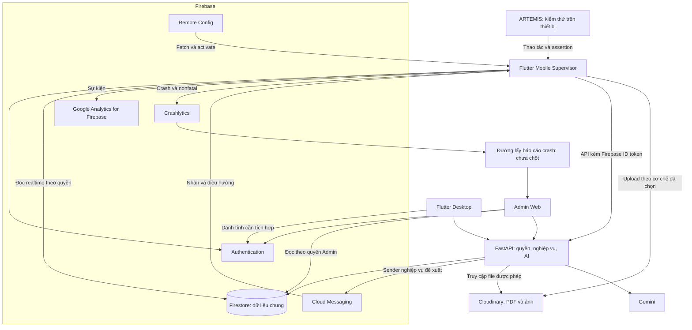

# Lộ trình kết hợp FastAPI, Firebase và Cloudinary

Cập nhật: 05/11/2026, Asia/Saigon. Baseline: `f3de9fe06fca298d6822ea9b22e55d03a6540c9c`,
nhánh `feat/firebase-setup`, có working tree chưa commit.

**Trạng thái: đề xuất để thống nhất thiết kế, chưa triển khai hoặc nghiệm thu.**
Người dùng yêu cầu cập nhật tài liệu sau trao đổi về DB chung và bổ sung đầy đủ
FCM, Analytics, Crashlytics, Remote Config, ARTEMIS. Yêu cầu này không chốt kiến trúc
hoặc giao triển khai toàn bộ. [ADR-0019](adr/0019-firebase-identity-and-data-ownership.md)
vẫn áp dụng cho mobile Lab 3 cho tới khi có quyết định thay thế.

## 1. Mục tiêu và hiện trạng

Mục tiêu đề xuất là một hệ thống có danh tính và dữ liệu nghiệp vụ chung, giữ backend
hiện có. Firebase là bộ dịch vụ; Firestore là DB được đề xuất dùng chung với FastAPI.
Không cần tạo DB thứ ba để đồng bộ hai bản dữ liệu nghiệp vụ ngang hàng.

Hiện Python lưu lớp/submission bằng JSON, cache/config dùng SQLite. Mobile vẫn chọn
`FakeAcademicRepository` cho học vụ. Màn `/firestore-projects` riêng đọc/ghi
`users/{uid}/projects`, chưa thay flow Class/Group/Project/Review hiện có.
Admin có readers Firestore nhưng xác thực vẫn mock. Xem [hiện trạng](project-status.md)
và [ghi nhận setup](firebase-connection-setup.md) để phân biệt code với evidence.

## 2. Phương án đề xuất và phân công

| Phương án | Phân công | Đánh đổi |
|---|---|---|
| Mọi dữ liệu qua FastAPI | Client gọi API; backend truy cập Firestore | Tập trung nghiệp vụ, cần thêm API và cách cập nhật realtime |
| Client ghi nghiệp vụ, FastAPI chỉ chấm AI | Client dùng Firestore trực tiếp | Phải giữ quy tắc review nhất quán trong Rules và giữa các client |
| Kết hợp có phân công, phương án đề xuất | Client đọc realtime theo quyền; backend xử lý AI và thao tác nghiệp vụ quan trọng | Cần bảng quyền và một bên chịu trách nhiệm cho mỗi thao tác ghi |

| Thành phần | Trách nhiệm dự kiến |
|---|---|
| Firebase Authentication | Google login, UID chung, trạng thái đăng nhập |
| Firestore | Lớp, nhóm, project, review, version, feedback, decision, metadata file |
| FastAPI | Xác minh danh tính, kiểm quyền, nghiệp vụ review, Gemini, quote verification, pacing/cache |
| Cloudinary | Bytes PDF/ảnh; Firestore chỉ giữ metadata và tham chiếu |
| SQLite và Sembast | Cache/config backend và lịch sử local theo vai trò hiện có; không là nguồn nghiệp vụ thứ hai |
| FCM | Gửi và nhận thông báo gắn đúng entity/version |
| Google Analytics for Firebase | Đo thao tác và các bước flow, đối chiếu bằng DebugView |
| Crashlytics | Thu crash thật, nonfatal và ngữ cảnh chẩn đoán |
| Firebase Remote Config | Defaults, fetch/activate, tham số thay đổi hành vi |
| ARTEMIS | Kiểm thử app qua thiết bị, nằm ngoài luồng chạy nghiệp vụ |

Sơ đồ biểu diễn đích đề xuất, không xác nhận các kết nối đã chạy thật.
Analytics, Crashlytics và Remote Config có nơi lưu/quản lý riêng. DB nghiệp vụ chung
không có nghĩa mọi dữ liệu của các dịch vụ đều chuyển vào Firestore.

## 3. Danh tính, quyền và mô hình chung

Client đăng nhập Firebase, lấy **Firebase ID token** rồi gửi tới FastAPI qua
`Authorization: Bearer <token>`. Backend xác minh token, lấy UID rồi kiểm quyền
với entity. Không tin UID do client tự gửi trong body hoặc `X-User-Id`.
Firebase ID token khác Google ID token dùng để đăng nhập và khác FCM registration token.

Backend dùng credentials của môi trường server để truy cập Firestore. Credentials
này khác token người dùng và không đưa vào Flutter. Server SDK dùng IAM, không chịu
Firestore Security Rules như client. API phải tự kiểm quyền; Rules bảo vệ đường
truy cập trực tiếp của mobile/web.

Các quyết định còn phải chốt trước khi viết migration:

- Quyền owner/Supervisor/Admin và danh tính desktop. Không lấy `users.role` do client
  sửa được làm căn cứ cấp quyền Admin.
- Path và ID chuẩn cho Class/Group/Project/Review, bao gồm dữ liệu project riêng hiện có.
- Python `changes_requested` với mobile `needsRevision`; `notAccepted` cần định nghĩa
  nghiệp vụ riêng, không tự ánh xạ thành trạng thái khác.
- Python tạo submission mới khi nộp lại, còn mobile giữ review ID và thêm version.
- Cách gán UID cho dữ liệu cũ chưa có chủ sở hữu. Không suy đoán ownership từ tên nhóm.
- Path báo cáo: Rules mới mở `reports`, service upload cũ và Admin vẫn dùng `srs_reports`.
- Quyền đọc file Cloudinary và cách backend truy cập PDF. URL không tự chứng minh file riêng tư.

Mỗi thao tác ghi có một bên chịu trách nhiệm. Nếu backend quyết định review thì
Rules không cho client tự ghi trạng thái duyệt hoặc kết quả AI chính thức.
Decision, feedback official và history cần cập nhật nguyên tử theo mô hình đã chốt.
Lời gọi Gemini nằm ngoài transaction; lúc ghi kết quả phải kiểm lại version/run token.
Retry một command không được tạo hai quyết định hoặc ghi đè lịch sử cũ.

## 4. Các mốc triển khai và nghiệm thu

Mọi mốc dưới đây đang mở. Đây là trình tự đề xuất, không phải kết quả đã hoàn thành.

| Mốc | Đầu ra | Điều kiện nghiệm thu |
|---|---|---|
| I0. Chốt phạm vi và model | ADR mới, schema, entity/status/version mapping, bảng quyền và bên ghi | Giải thích được v1 → yêu cầu sửa → v2 → duyệt; phân biệt bản nộp Lab 3 với kiến trúc sản phẩm |
| I1. Nối Auth | FastAPI xác minh ID token; mobile/Admin login thật; phương án identity desktop | Token thiếu/sai/hết hạn bị từ chối; A không thao tác dữ liệu B; Admin đúng quyền |
| I2. Nối DB chung | Repository Firestore cho backend, schema/path/index và Rules nhất quán | API ghi entity, mobile đọc cùng ID; allowed/denied tests chạy bằng emulator |
| I3. Chuyển một flow hiện có | Thay fake theo workflow, UI loading/empty/error/retry | Flow F1 hoặc F2/F3 được chọn chạy dữ liệu chung; realtime, restart và history được kiểm |
| I4. Nối file và AI | PDF → Cloudinary → metadata → truy cập file → review đúng version | File mở được; lỗi upload/AI giữ draft; retry không tạo kết quả trùng; giữ cache/pacer |
| I5. Dịch vụ Firebase và Admin | Các luồng ở mục 5 nối UI, phân quyền và xử lý lỗi | Có bằng chứng Android thật, Console và Admin web tương ứng |
| I6. Kiểm thử và hồ sơ | AI E2E, review code/Rules, fidelity, report/slides/video | Đạt checklist của phiên bản đề áp dụng, logs gắn account/seed/device/version |

Không đưa toàn bộ `AcademicSnapshot` lên một document. Chuyển từng workflow sau
khi chốt schema. Dữ liệu cũ cần backup, dry-run, ID mapping và kiểm trước/sau;
không ghi song song JSON và Firestore như hai nguồn dữ liệu nghiệp vụ ngang nhau.
Kiểm API/AI bằng fake upstream trước, không gọi Gemini tốn quota chỉ để kiểm kết nối.

## 5. Không bỏ sót các dịch vụ Lab 3

| Hạng mục | Luồng cần có | Bằng chứng cần thu |
|---|---|---|
| FCM | Xin quyền; lấy/lưu/refresh token theo user/device; sender; nhận foreground/background/terminated; inbox và tap đúng entity/version | Console send; nếu có sender nghiệp vụ thì log API tương ứng; video ba trạng thái và từ chối quyền |
| Analytics | Event plan → caller sau thao tác → typed params; login/logout/screen/detail/CRUD/export và event riêng theo flow | DebugView từng event, không PII, gắn thao tác và phiên bản |
| Crashlytics | Nonfatal thực tế; UID/custom keys; nút crash native thật; mở lại để gửi báo cáo | Cùng sự cố đối chiếu trên device, Firebase và web Admin |
| Remote Config | Ít nhất hai defaults và hai giá trị từ xa đổi hành vi; hiển thị Profile; fallback offline | Trước/sau publish, hành vi đổi không rebuild, kiểm lỗi fetch |
| Admin crash | Chọn đường lấy báo cáo Crashlytics đã nhận, quyền và độ trễ; list/detail/error/refresh | Admin xem báo cáo tương ứng Firebase, không chỉ bản ghi yêu cầu crash |
| ARTEMIS | Tối thiểu 10 case, mỗi case ít nhất 3 lượt và exploratory 15–30 phút theo PDF hướng dẫn | Starting state, assertion nhìn thấy, logs, pass/fail và rerun |

Đây là đầu ra cần có, không phải tuyên bố code đang thiếu toàn bộ. Bootstrap FCM,
Analytics adapter/callers và Crashlytics đã có một phần; xem [hiện trạng](project-status.md).
Crash mirror do app ghi trước crash chỉ chứng minh yêu cầu crash. Đường đưa báo cáo
Crashlytics đã nhận tới Admin chưa chốt; không mặc định mirror hay BigQuery đã giải quyết.
Trong debug, kiểm cấu hình `CRASH_REPORTING` trước khi thu evidence.

PDF Lab 3 17 trang yêu cầu MobAI, còn PDF hướng dẫn 25 trang dùng ARTEMIS.
Người dùng nhắc ARTEMIS trong annotation chưa phải xác nhận thầy cho bỏ MobAI.
Giữ riêng khác biệt này; không tự thay bằng Flutter tests hoặc công cụ khác.
PDF Lab 3 cũng để custom backend ngoài phạm vi. Cần chốt bản đem nộp, không coi
FastAPI kết hợp tự động đáp ứng đề. Xem [checklist đầy đủ](lab3-completion-checklist-2026-11-05.md).

Slide phải giải thích nguyên lý và chỉ đúng file/hàm: Auth, DB/quyền, upload,
token FCM/sender/receiver, Analytics, crash/report Admin, Remote Config và kiểm thử.
Thầy yêu cầu chấm trên device thật, Dev xem Firebase và Admin xem web của team.

## 6. Nguồn và bước tiếp theo

- [ADR hiện hành](adr/0019-firebase-identity-and-data-ownership.md), [model Firebase](../mobile/docs/firebase-data-model.md), [ba flow](../mobile/docs/mobile-grading-compliance.md).
- [Xác minh Firebase ID token](https://firebase.google.com/docs/auth/admin/verify-id-tokens), [Admin SDK Python](https://firebase.google.com/docs/admin/setup), [client/server SDK và Security Rules](https://firebase.google.com/docs/firestore/client/libraries).
- [Evidence cập nhật tài liệu](evidence/firebase-integration-docs-2026-11-05.md).

Bước kế tiếp là I0: bản thiết kế cho một flow review v1/v2, gồm schema, API, quyền,
bên ghi và mapping dữ liệu cũ. Chỉ thay ADR khi có quyết định kiến trúc thực sự.
