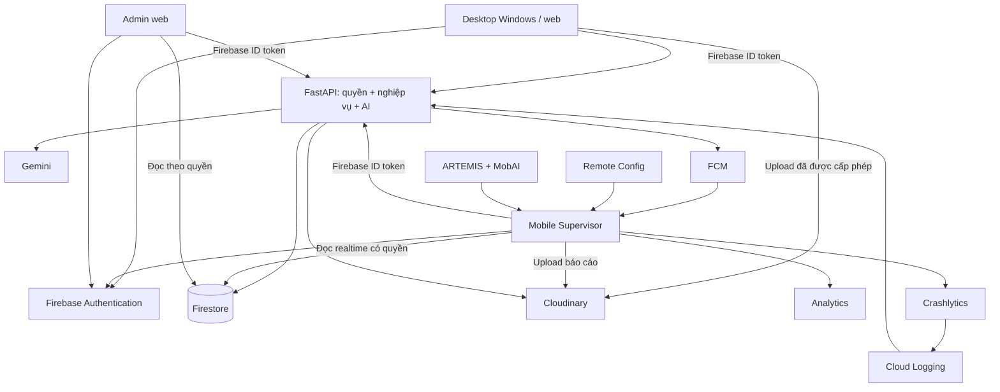

# Plan 13: Hợp nhất FastAPI, Firebase và Cloudinary, hoàn thiện Lab 3

Ngày: 05/11/2026, Asia/Saigon. Baseline khảo sát:
`f3de9fe06fca298d6822ea9b22e55d03a6540c9c`, nhánh `feat/firebase-setup`.

Mốc trên là baseline khảo sát lịch sử. HEAD khi rà lại tài liệu ngày 05/11 là
`473bf720d90a43498229901611e70042062324a8`, commit đã đưa bộ Plan 13 vào repo.
Không chuyển kết quả đo ở `f3de9fe` thành kết quả của `473bf72`. WP0 phải chạy
lại context, inventory và các phép đo baseline trên HEAD thực tế lúc bắt đầu,
ghi đầy đủ commit và working tree; nếu HEAD đổi thì dùng mốc mới đó.

Trạng thái: đã lưu kế hoạch và các lựa chọn người dùng xác nhận trong hội thoại.
**Chưa triển khai WP0–WP15, chưa thay ADR-0019, chưa migrate hoặc deploy.**
Yêu cầu của lượt lưu tài liệu chỉ là ghi plan và notes vào repo. Không tự xem đây
là lệnh bắt đầu triển khai, dùng quota AI hoặc thay cấu hình cloud.

- [Tiến độ và các điểm đang chờ](13-progress.md).
- [Prompt giao việc cho agent](13-handoff-prompt.md).
- [Hiện trạng checkout](../project-status.md).
- [Roadmap nền](../firebase-backend-integration-roadmap.md).
- [Checklist Lab 3](../lab3-completion-checklist-2026-11-05.md).

## 1. Mục tiêu, phạm vi và cách thực hiện

Plan dành cho agent triển khai tiếp repo `srs-review-ai`. Mục tiêu là giữ nghiệp
vụ hiện có, chuyển sang danh tính và dữ liệu chung, rồi nghiệm thu bằng ứng dụng
thật, dữ liệu thật và bằng chứng kiểm thử.

### 1.1. Notes đã được người dùng xác nhận

Các lựa chọn dưới đây lấy từ câu trả lời trực tiếp của người dùng ngày 05/11.
Agent tiếp quản không hỏi lại các lựa chọn này nếu không có ràng buộc mới.

| Nội dung | Quyết định |
|---|---|
| Phạm vi | Hợp nhất hệ thống và hoàn thiện Lab 3 |
| Backend | Giữ FastAPI để xử lý quyền, nghiệp vụ và AI |
| Database nghiệp vụ | Firestore |
| Lưu tệp | Cloudinary |
| Mobile | Android cho Supervisor |
| Desktop | Windows và bản web hiện có cùng tham gia flow |
| Admin | Web đăng nhập thật, xem dữ liệu và báo cáo crash |
| Quyền học vụ | Một Supervisor sở hữu mỗi lớp; Student trong nhóm được nộp bài |
| Project cá nhân | Giữ riêng với project học vụ; không tự gán lớp/nhóm |
| Dữ liệu cũ | Chuyển toàn bộ dữ liệu thật, có kiểm kê và đối chiếu |
| Đăng nhập Windows | Mở trình duyệt Google rồi quay lại app, tránh Firebase C++ |
| Môi trường nghiệm thu | FastAPI local/LAN trước; deploy public là chặng riêng |
| Công cụ AI E2E | Làm cả ARTEMIS và MobAI |
| Xác nhận về đề | Người dùng trả lời thầy cho FastAPI và cần cả hai công cụ; đây là xác nhận do người dùng cung cấp, không phải văn bản giảng viên đã kiểm độc lập |
| Chi phí | Dừng trước mọi khoản phí mới; không tự bật billing hoặc nâng gói |
| Cách làm | Hoàn tất từng chặng phải kiểm thử lại; thiếu gì ngoài quyền agent thì dừng và yêu cầu chính xác đầu vào |
| Console | Người dùng sẵn sàng tự cấu hình Firebase/Cloudinary khi agent chỉ rõ màn hình, field, giá trị và cách kiểm |

Không đưa toàn bộ backlog engine tháng 9 hoặc yêu cầu Final vào plan này nếu
chúng không cần cho các flow bên dưới. Student sử dụng desktop và bản web hiện
có của desktop; không tạo một Student Web mới chỉ vì tài liệu lịch sử nhắc Web.

### 1.2. Kết quả cuối phải chứng minh được

1. Supervisor quản lý học vụ bằng dữ liệu Firestore thật.
2. Student dùng desktop Windows hoặc desktop web để nộp tài liệu.
3. Mobile nhận đúng bài, mở đúng tệp và chạy AI qua FastAPI.
4. Supervisor công bố feedback cho v1 và yêu cầu sửa.
5. Student nhận feedback, nộp v2 trong cùng review.
6. Supervisor duyệt v2; lịch sử v1 còn nguyên.
7. Admin đăng nhập thật, xem báo cáo và sự cố Crashlytics đã được Firebase nhận.
8. FCM, Remote Config và Analytics có hành vi thật và evidence tương ứng.
9. Toàn bộ dữ liệu thật đã kiểm kê được chuyển, hoặc ghi rõ là đang bị chặn.
   Không bỏ qua bản ghi để đạt tỷ lệ hoàn thành.
10. Có đủ kiểm thử, báo cáo, slides, video và hồ sơ Lab 3.

### 1.3. Baseline đã khảo sát trước khi lưu plan

- Working tree có thay đổi và file mới của người dùng; phải giữ nguyên.
- Học vụ mobile vẫn chọn fake repository.
- Module `users/{uid}/projects` là project cá nhân riêng.
- Admin auth còn mock; Python dùng capability ID và class write key.
- Rules mở `reports`, nhưng service cũ và Admin đọc `srs_reports`.
- Ruff check và format check server đạt trong lượt lập plan trước đó.
- `git diff --check` đạt trong lượt lập plan trước đó.
- Guardrails thất bại với **61 vi phạm**, thuộc layering, design tokens và
  full-screen surfaces. Đây là số đo của lượt lập plan, cần đo lại ở WP0/WP1.
- Flutter cache trên máy ghi Flutter `3.47.4`, Dart `3.13.3`; CI pin bản cũ hơn.
- Không chạy lại toàn bộ app tests, cloud hoặc device chỉ để lập/lưu plan.
- Kết quả mobile 260 pass/3 fail trong project-status là evidence của lượt khảo
  sát đã được ghi ở đó, không phải phép đo mới của lượt lưu plan.

Đã đọc hai PDF gốc được checklist dẫn tới. Hai PDF khác công cụ kiểm thử và
phạm vi custom backend; lựa chọn áp dụng cho plan này đã ghi ở mục 1.1.

### 1.4. Quy tắc thực thi và điểm dừng

Thực hiện từng WP theo thứ tự:

`TODO → IMPLEMENTING → LOCAL_PASS → VERIFIED`

Nếu thiếu đầu vào ngoài repo:

`IMPLEMENTING hoặc LOCAL_PASS → WAITING_USER`

- Chỉ chuyển `VERIFIED` khi đủ kiểm thử và bằng chứng quy định cho WP.
- Test thất bại thì sửa và chạy lại phần liên quan trước khi đi tiếp.
- Không sửa assertion, skip test hoặc record lại golden chỉ để suite xanh.
- Không dùng fake làm fallback âm thầm trong bản tích hợp.
- Không coi build, HTTP 200 hoặc SDK đã cài là bằng chứng flow hoạt động.
- Không deploy, gọi AI thật, ghi dữ liệu thật hoặc thay billing để kiểm kết nối.
- Hoàn tất phần local và chuẩn bị kết quả xem xét được trước khi nhờ người dùng.
- Thiếu cấu hình thì dừng phần phụ thuộc, gửi yêu cầu theo mục 5.2.
- Phần độc lập chỉ tiếp tục nếu không vượt điều kiện chặn và phạm vi đã giao.
- Mỗi WP cập nhật progress, evidence và project-status. Không đợi cuối plan.
- Không hỏi lại quyền đã được người dùng giao; không tự suy quyền cho thao tác
  cloud, xuất bản hoặc chi phí chưa được giao.

## 2. Thiết kế phải giữ thống nhất

Đây là thiết kế đích cho agent cụ thể hóa thành ADR/contract ở WP2. Không mô tả
những API, collection hoặc kết nối dưới đây như code đã tồn tại.

### 2.1. Phân công thành phần

Chọn client đọc realtime, FastAPI sở hữu các thao tác ghi nghiệp vụ chính.

| Thành phần | Trách nhiệm |
|---|---|
| Firebase Authentication | Google login và Firebase UID |
| FastAPI | Xác minh token, kiểm quyền, thực hiện command, quản lý AI |
| Firestore | Nguồn dữ liệu nghiệp vụ chung |
| Cloudinary | Bytes tài liệu, báo cáo và asset được chuyển từ hệ thống cũ |
| Mobile | UI Supervisor, đọc realtime, gửi command qua API |
| Desktop | Nhập/phân tích tài liệu, nộp bài, đọc feedback, nộp lại |
| Admin web | Quyền tài khoản, đọc users/reports/crash theo quyền |
| SQLite | Cache và cấu hình engine theo vai trò hiện có |
| Sembast | Lịch sử local; thêm khả năng đồng bộ bản lưu riêng của user |
| FCM | Báo có thay đổi; inbox là nguồn thông báo bền vững |
| Analytics | Đo sự kiện sử dụng |
| Crashlytics | Nhận lỗi và crash |
| Remote Config | Thay đổi hành vi client được cho phép |
| ARTEMIS, MobAI | Công cụ kiểm thử ngoài luồng runtime |

Không đưa toàn bộ Analytics, Crashlytics hoặc Remote Config vào Firestore.

Sơ đồ là đích triển khai, **chưa phải kết quả đã nghiệm thu**:



### 2.2. Danh tính và quyền

Nguồn quyền đáng tin cậy là `accessGrants/{uid}`:

```text
role: supervisor | student | admin
active: boolean
revision: integer
updatedAt: timestamp
updatedBy: uid hoặc thông tin bootstrap
```

- Client không tạo/sửa grant. Admin đầu tiên bootstrap bằng Console hoặc công
  cụ quản trị local. Admin tiếp theo quản lý quyền qua API có kiểm quyền.
- `users/{uid}.role` cũ không dùng để cấp quyền.
- Alias `teacher` chỉ chuyển thành `supervisor` trong migration có ghi nhận.
- Thiếu grant không tự trở thành Supervisor.
- Mobile nhận Supervisor, desktop flow nộp nhận Student, Admin web nhận Admin.
- Sai vai trò phải có thông báo và không mount dữ liệu ngoài quyền.
- API lấy UID từ Firebase ID token đã xác minh, không từ body, tên hoặc email.
- Firebase ID token khác Google ID token, Firebase custom token và FCM token.
- Server SDK vượt Firestore Rules; API tự kiểm toàn bộ quyền nghiệp vụ.

| Thao tác | Supervisor | Student | Admin |
|---|---|---|---|
| CRUD học vụ | Chỉ dữ liệu mình sở hữu | Không | Không sửa hoặc duyệt thay |
| Đọc project học vụ | Thuộc lớp mình | Project mình là thành viên | Metadata quản trị; phạm vi field phải khóa trong ADR WP2 |
| Nộp v1/v2 | Không giả danh Student | Đúng project/trạng thái | Không |
| AI hỗ trợ review | Đúng review mình sở hữu | Self-check riêng, không thành kết quả chính thức | Không |
| Draft feedback | Tác giả trong review có quyền | Không đọc | Không công bố thay |
| Official feedback/decision | Đọc/tạo đúng quyền | Đọc trong project mình | Đọc theo phạm vi báo cáo quản trị |
| Đổi decision cũ | Không | Không | Không |
| Project cá nhân | Chính chủ | Chính chủ | Không mặc định đọc |
| Reports | Owner hoặc quyền review liên quan | Owner hoặc project liên quan | Đọc |
| Crash toàn hệ thống | Không mặc định đọc | Không | Đọc |
| Cấp/thu hồi quyền | Không | Không | Qua API quản trị |

Không dùng matrix này để mở toàn bộ PII cho Admin. WP2 phải ghi rõ query/field
được đọc và kiểm denied cho phần còn lại trước khi mở Rules.

### 2.3. Đăng nhập desktop Windows và web

Giữ desktop không phụ thuộc Firebase C++.

1. Desktop tạo phiên kết nối đăng nhập có thời hạn 5 phút.
2. Desktop giữ bí mật xác nhận trong bộ nhớ, gửi mã băm lên backend.
3. Mở trang Google login trong trình duyệt hệ thống.
4. Trang web đăng nhập Firebase, hiển thị tài khoản và mã xác nhận.
5. Backend xác minh Firebase ID token của trình duyệt.
6. Desktop chứng minh mình giữ bí mật của phiên kết nối.
7. Backend trả Firebase custom token một lần cho đúng phiên.
8. Desktop đổi custom token lấy ID token/refresh token qua Firebase Auth REST.
9. API nghiệp vụ tiếp tục dùng Firebase ID token.

Ràng buộc:

- Không đặt token trong URL, access log hoặc clipboard.
- Không lưu refresh token trong Sembast/SharedPreferences.
- Windows dùng kho credential hệ điều hành có fake cho test.
- Desktop web giữ credential trong phạm vi phiên; đóng browser có thể phải login lại.
- Hết hạn, sai mã, replay hoặc hủy phiên đều bị từ chối.
- Không tin UID do trang login tự khai; không mint quyền Admin vào custom token.
- Thiếu quyền ký token thì dừng yêu cầu IAM, không thay bằng token tự chế.
- Bridge local dùng loopback; không phát hành cơ chế này trên HTTP public.

Nguồn: [Firebase Auth REST](https://firebase.google.com/docs/reference/rest/auth)
và [custom tokens](https://firebase.google.com/docs/auth/admin/create-custom-tokens).

### 2.4. Dữ liệu chuẩn

API nghiệp vụ mới ở `/v2`; contract engine review hiện có giữ riêng.

```text
schemaVersion = 2
revision theo entity
createdAt / updatedAt
createdBy / updatedBy
```

- Timestamp UTC; ngày thuần `yyyy-MM-dd` theo Asia/Saigon.
- ID mới do server sinh, độc lập mã/tên.
- Command cập nhật mang `expectedRevision`.
- Enum lạ trả `invalidData`, không tự đổi thành approved.
- Update chỉ ghi field được command cho phép.
- Dữ liệu lớn ở subcollection/asset, không nhét snapshot toàn app vào một doc.

| Nhóm | Nơi lưu chuẩn | Quy tắc |
|---|---|---|
| Hồ sơ/quyền | `users`, `accessGrants` | Tách profile khỏi quyền |
| Học vụ | `semesters`, `courses`, `offerings`, `classes` | `ownerUid` của Supervisor |
| Sinh viên | `students`, `enrollments` | Student ID học vụ khác Firebase UID |
| Nhóm/project | `groups`, `projects` | Một active project/group |
| Bộ quy tắc | `ruleSets/{id}/versions/{versionId}` | Version đã dùng bất biến |
| Tài liệu | `documents` | Danh tính độc lập filename |
| Review | `reviewRequests/{reviewId}` | Giữ ID qua v1/v2 |
| Phiên bản | `reviewRequests/{id}/versions` | Bất biến |
| Feedback | `reviewRequests/{id}/feedback` | Draft sửa được; official bất biến |
| AI | `reviewRequests/{id}/evaluations` | Mỗi run một ID |
| Decision | `reviewRequests/{id}/decisions` | Append-only |
| Audit | `reviewRequests/{id}/audit` | Append-only; Student không đọc draft history |
| Tệp | `assets`, upload intents nội bộ | Metadata, không PDF/base64 |
| Báo cáo | `reports` | Writer/reader/Rules cùng path |
| Thiết bị | `users/{uid}/devices/{installationId}` | FCM token không ở profile công khai |
| Inbox | `users/{uid}/inbox/{eventId}` | Read receipt riêng user |
| Project cá nhân | `users/{uid}/projects/{projectId}` | Không tự đổi thành học vụ |
| Phiên local đồng bộ | `users/{uid}/savedSessions` | Payload lớn trong asset riêng |
| Migration | Manifest/mapping nội bộ | Client không được ghi |

Reservation mã môn/mã lớp/tên nhóm/active project ghi cùng transaction với entity.
Không dùng counter fixture làm sự thật; Dashboard lấy query/projection có nguồn.

### 2.5. Vòng đời review

Giữ riêng trạng thái Supervisor, trạng thái AI và version tài liệu.

```text
waiting → inReview
waiting hoặc inReview → approved | needsRevision | notAccepted
needsRevision → waiting khi Student nộp version mới
```

- `needsRevision` có feedback công bố; `notAccepted` có lý do.
- Approved có note tùy chọn; AI không tự approve.
- Rule Set không active thì không quyết định.
- AI bắt buộc đòi evaluation thật completed cho đúng version.
- Mock, partial hoặc lỗi không thỏa prerequisite.

Decision command kiểm `commandId`, `expectedRevision`, `expectedVersionId`,
`decision`, `selectedFeedbackIds`, `note`.

Một transaction kiểm quyền/version/policy, tạo decision, công bố feedback đúng
version, tạo audit, cập nhật review và tạo sự kiện thông báo bền vững.
Không gọi Gemini/FCM trong transaction.

Cùng command ID/cùng payload trả kết quả cũ; cùng ID/khác payload trả conflict.

### 2.6. API và lỗi

| Nhóm | Giao tiếp cần có |
|---|---|
| Phiên | Đồng bộ profile an toàn, đọc quyền hiện tại |
| Desktop auth | Tạo/xác nhận/nhận kết quả/hủy phiên kết nối |
| Học vụ | List/detail/create/update/delete hoặc archive theo entity |
| File | Upload intent, finalize, quyền mở/download |
| Review | Nộp đầu, bắt đầu review, draft feedback, quyết định |
| Revision | Nộp v2+ với cùng review ID |
| AI | Tạo evaluation, tiến độ/kết quả từng unit |
| Thông báo | Đăng ký/hủy thiết bị, inbox, read receipt |
| Admin | Users/reports/crash; cập nhật access grant có kiểm quyền |

Các entrypoint command dự kiến:

```text
POST /v2/projects/{projectId}/reviews
POST /v2/reviews/{reviewId}/revisions
POST /v2/reviews/{reviewId}/start
POST /v2/reviews/{reviewId}/decisions
POST /v2/reviews/{reviewId}/evaluations
POST /v2/assets/upload-intents
POST /v2/assets/{assetId}/finalize
POST /v2/assets/{assetId}/download
```

List mặc định 25, tối đa 100 bản ghi; cursor ổn định.
Queue theo `updatedAt DESC`, rồi ID. Lỗi chuẩn:

```text
error.code
error.message
error.operationId
error.retryable
```

Phân biệt `unauthenticated`, `permissionDenied`, `notFound`, `validation`,
`conflict`, `staleVersion`, `networkUnavailable`, `quotaExceeded`,
`providerUnavailable`, `invalidData`. Không trả revision/version hiện tại cho
người không có quyền đọc entity.

### 2.7. File, AI và dữ liệu lịch sử

File:

- Upload trực tiếp Cloudinary sau khi API cấp phép; signed upload, đọc có kiểm soát.
- API secret chỉ ở backend.
- Source PDF/DOCX theo khả năng hiện có; báo cáo mobile là PDF.
- Finalize kiểm asset/owner/size/type/hash ở server, không tin URL client gửi.
- Lưu reference ổn định; cấp URL có thời hạn lúc mở.
- Upload xong/finalize lỗi có retry tìm lại asset, tránh upload trùng.
- Không gửi file lớn trong JSON qua FastAPI.
- PDF report phải sinh từ dữ liệu, filter, review/version đang xem; không lấy file mẫu.

Cloudinary Free liệt kê trần raw file 10 MB trong bảng giá đã tra ở lượt lập plan.
OTES 28,7 MB vì thế là **điểm chặn cần kiểm hạn mức tài khoản thực tế**.
Không tự hạ trần app, đổi bytes hoặc nâng gói.
[Giới hạn Cloudinary](https://cloudinary.com/pricing/compare-plans).

AI:

- Tái sử dụng engine/quote verification/cache/pacer.
- Desktop cung cấp bản phân tích đóng băng gắn hash tài liệu/parser version.
- Server kiểm cấu trúc/nguồn trích, lưu provenance.
- Nội dung chưa đối chiếu được không được ghi là verified.
- Evaluation gắn review/version/rule snapshot/hash/config.
- Điểm per-unit giữ là per-unit, không tự biến thành điểm học phần.
- Tiêu chí chưa có mapping hợp lệ sang engine cần chấm thủ công, không gán điểm giả.
- Luật mới đi từ `review-rules/` và `app-port-map.md`.

Migration:

- Giữ backup nguyên bản; không suy owner từ tên nhóm/email gần giống.
- Không biến người nhập thành người đã quyết định trong quá khứ.
- Actor cũ chưa biết để null, giữ nhãn cũ/provenance.
- Không đổi nhãn AI cũ thành kết quả mới đã kiểm chứng.
- Giữ legacy ID/source system/thời gian nguồn/hash để đối chiếu.

## 3. Các chặng triển khai và điều kiện qua chặng

### WP0. Khóa baseline và kiểm kê đầu vào

Thực hiện:

1. Đọc AGENTS/hướng dẫn con, chạy context script, đọc diff.
2. Ghi inventory modified/untracked trước khi sửa.
3. Backup riêng công việc có sẵn; không reset/clean/stash để làm sạch.
4. Kiểm kê JSON classes/submissions, uploads, HTML report/share, SQLite
   cache/config, Sembast Windows, IndexedDB profile web cố định, Firestore
   project cá nhân/profile/reports/mirror crash.
5. Tách fixture khỏi dữ liệu thật theo nguồn tạo và xác nhận của người dùng.
6. Lập manifest số bản ghi/file/size/hash/nơi lưu, không commit payload nhạy cảm.

Kiểm thử: context đọc được đầu vào; inventory fail khi thiếu nguồn bắt buộc;
backup đọc lại khớp hash; giữ exit code từng lệnh.

Qua chặng: có baseline và manifest đủ, biết rõ nguồn chưa truy cập được.

Dừng khi thiếu profile Chrome cũ, DB local, file gốc hoặc quyền cloud. Yêu cầu
đúng đường dẫn/export, không kết luận nguồn rỗng khi chưa đọc được.

### WP1. Khôi phục bộ kiểm tra đáng tin cậy

Thực hiện:

1. Pin local/CI Flutter `3.47.4`, Dart `3.13.3` phù hợp checkout đã khảo sát.
2. Sửa guardrails theo nhóm: wiring về composition root; dùng tokens đúng hệ;
   modal desktop dùng full-screen surface theo ADR.
3. Không nới regex/thêm ngoại lệ để né lỗi.
4. Đo baseline server/desktop/mobile/Admin.
5. Tìm visual artifact cũ trước; không có thì ghi thiếu evidence. Baseline mới
   chỉ lập sau khi đối chiếu và người dùng xác nhận.
6. Thêm CI mobile/Admin/Rules riêng; không gộp build các app.

Kiểm thử: guardrails/tool tests, Ruff check/format, analyze/tests từng app,
Windows native build. Visual test không âm thầm bật record mode.

Qua chặng: sửa và đo lại lỗi thuộc chặng. Test còn bị chặn phải có nguyên nhân
và đầu vào cụ thể; không báo toàn hệ thống xanh khi thiếu phép đo.

### WP2. Ghi ADR và khóa hợp đồng tích hợp

Thực hiện:

1. Kiểm số ADR kế tiếp rồi tạo ADR-0020, ghi phạm vi supersede ADR-0019; giữ file cũ.
2. Chốt schema, query/field quyền Admin, vòng sửa và write ownership theo mục 2.
3. Mapping `changes_requested → needsRevision`; `submitted/reviewed` không tự
   thành approved; chuỗi submission thành review/versions; `notAccepted` riêng.
4. Tạo package Dart thuần DTO/enums/errors chung ba client, không SDK/widget.
5. Models viết tay; Python/Dart cùng đọc fixtures contract.
6. Lập danh sách command của mọi nút học vụ đang hiển thị, kể cả nút đang gọi fake.

Kiểm thử: codecs time/enum/null/revision; `labOverride` vắng khác rỗng; enum lạ
fail rõ; Python/Dart đọc cùng fixture; không gộp state AI và Supervisor.

Qua chặng: không còn quyết định mở về path/owner/status/version/bên ghi trong
flow chính. Đọc ADR nghiệp vụ và source trước khi chuyển policy cũ.

### WP3. Firebase identity cho FastAPI, mobile và Admin

Thực hiện:

1. Thêm Firebase Admin SDK được pin, khởi tạo bằng credential môi trường.
2. Xây Principal từ ID token/grant, kiểm project/expiry/revoked/disabled.
3. Đường tích hợp dùng UID thật, không tin `X-User-Id`.
4. Mobile bỏ tự gán `teacher`; Profile tên/ảnh/email thật.
5. Admin bỏ mock auth, Google login thật.
6. Chặn query/listener trước khi xác định grant.
7. Logout hủy listener/tác vụ/draft UI/identity telemetry của phiên cũ.

Kiểm thử: thiếu/sai/hết hạn/sai-project token; grant thiếu/inactive/sai role;
sửa `users.role` không tăng quyền; A không truy cập B; callback muộn không rò
dữ liệu; cấu hình tích hợp không chọn mock auth.

Qua chặng: mobile/Admin login thật, API đúng UID, allowed/denied đạt.

Dừng khi cần Google provider, SHA, web domain, access grant hoặc IAM.

### WP4. Đăng nhập desktop Windows và web

Thực hiện:

1. Browser bridge theo mục 2.3, session ID ngẫu nhiên/mã xác nhận/bí mật app.
2. Mint custom token sau khi kiểm phiên và Firebase user.
3. Auth REST đổi/refresh token; token provider cho HTTP client.
4. 401 do expiry refresh một lần rồi thử lại, command giữ nguyên ID.
5. Windows kho bảo mật có fake; web giữ origin/profile cố định cho lịch sử.

Kiểm thử: đúng UID; cancel/timeout/browser đóng; sai mã/replay/hai app; nhận
biết sai tài khoản trước confirm; refresh fail về login; không token trong
URL/log/history DB; build/chạy Windows; login web origin cố định.

Qua chặng: cả Windows/web gọi API bằng Firebase identity, không Firebase C++.

### WP5. Firestore và lát cắt học vụ tối thiểu

Thực hiện:

1. Repository server sau interface, Rules deny-by-default.
2. Ghi học vụ qua API; mobile realtime theo owner UID.
3. Lát cắt Course → Offering → Class → Group → Project.
4. Seed lặp lại được trên emulator.
5. Personal projects giữ collection riêng; nâng schema/revision có compatibility.
6. Thay repository màn đã migrate, không upload snapshot toàn app.
7. Loading/empty/error/retry thật.

Kiểm thử: API tạo/mobile đọc cùng ID; hai client tạo project/group chỉ một
thắng; owner filter/sort/limit/cursor; restart còn data; Rules chặn client ghi
nghiệp vụ; personal project đúng owner; Firestore lỗi không về fixture.

Qua chặng: chuỗi nhỏ chạy thật, Rules/API tests và listener UI có evidence.

Dừng khi thiếu cấu hình/deploy Rules/index. Chuẩn bị diff và lệnh trước khi nhờ.

### WP6. File Cloudinary, PDF export và reader

Thực hiện:

1. Intent có purpose/owner/project/name/MIME/size/hash dự kiến.
2. Kiểm quyền trước ký; client upload trực tiếp có progress/cancel/retry.
3. Finalize bằng dữ liệu Cloudinary đã xác thực và kiểm nội dung.
4. Chỉ lưu metadata sau khi xác nhận asset; download kiểm quyền, URL có hạn.
5. Reader mở file thật theo version, giữ preview/version binding.
6. PDF generator lấy dữ liệu/filter/review/version đang xem, có branding,
   generatedAt/format version; lỗi generate không ghi metadata success.
7. Report PDF upload/open được từ mobile và đọc đúng trong Admin.
8. Cleanup upload dở, không xóa asset còn được version/report tham chiếu.

Kiểm thử: PDF/DOCX/report PDF; sai extension/MIME/hỏng/rỗng/quá size; đổi file
dùng lại intent; asset/URL người khác; mất mạng giữa upload/finalize; finalize
retry không trùng; URL hết hạn xin lại; hash đúng; PDF nội dung đúng scope.
OTES 28,7 MB kiểm riêng theo hạn mức tài khoản, không lấy PDF nhỏ làm proof.

Qua chặng: upload → metadata → mở sau restart; denied đạt; export đúng data.

Dừng khi size/tính năng cần phí mới. Không nén mất dữ liệu, chia file, đổi nhà
cung cấp hoặc nâng gói âm thầm.

### WP7. F3 thật bằng nhánh review thủ công hợp lệ

Thực hiện:

1. Desktop chọn project có quyền, nộp v1: document/review/version bất biến.
2. Mobile queue nhận qua listener; mở PDF, thêm/sửa draft feedback.
3. Transaction needsRevision; desktop đọc official feedback.
4. Desktop nộp v2 đúng điều kiện, cùng review ID và version ID mới.
5. Supervisor duyệt v2; History/Versions mở được v1/v2.
6. Dùng Rule Set cho manual rõ ràng; không tắt guard của rule bắt buộc AI.

Kiểm thử: duplicate submit; resubmit sai status; feedback khác version; stale
decision; confirm hai lần; commit xong/mất response; Student không đọc draft
hoặc internal audit; detach không xóa lịch sử. Chạy Windows rồi desktop web.

Qua chặng: evidence F3 desktop → mobile → desktop, không dùng nút seed v2 thay
bằng chứng Student nộp thật.

### WP8. AI thật cho F2, giữ cache/quota/pacer

Thực hiện:

1. Evaluation job bền vững trong Firestore; API trả ID sớm, mobile theo dõi.
2. Worker cùng tiến trình API trong môi trường local/LAN; nghiệm thu một process
   để pacer toàn cục giữ đúng phạm vi. Job có lease và phục hồi sau restart.
3. Đóng băng version/Rule Set/config lúc tạo run.
4. Gọi application service hiện có, không gọi Gemini từ route hoặc Flutter.
5. Giữ cap 40 unit/run và quota hiện hành; cache hit không tiêu quota mới.
6. Batch tối đa 6 text unit; unit có ảnh đi riêng.
7. Lưu kết quả từng unit và kênh failed; retry phần thiếu, dùng lại cache.
8. Run version cũ chỉ cập nhật lịch sử, không ghi đè current version.
9. Partial hiển thị rõ; mock không thỏa prerequisite AI thật.
10. Mapping tiêu chí dựa `criterion_id`/snapshot, không gán score tổng giả cho
    tiêu chí chưa được engine chấm. Người dùng chọn/sửa feedback trước công bố.

Job states: `queued`, `running`, `completed`, `partial`, `failed`, `cancelled`.

Kiểm thử:

- Fake provider success/thiếu unit/JSON lỗi/429/502/503.
- HTTP 200 nhưng toàn bộ failed không thành completed.
- Cùng đầu vào dùng cache; đổi section/image/page/Rule Set/config ảnh hưởng
  prompt đổi cache key.
- Restart giữ kết quả; version đổi khi job chạy; logout giữa run.
- Client không retry thêm 502 sau khi server đã retry hết.
- Không vượt quota bằng giả `X-User-Id`.
- Engine regressions hiện có vẫn đạt; không đổi rubric/rules để làm test xanh.

Qua chặng: fake upstream đạt trước, rồi tập input nhỏ chạy Gemini thật trong
quota người dùng đã cho phép. Evidence có requested/succeeded/failed/cached và
số call upstream; không chỉ log status HTTP ngoài.

Dừng khi thiếu credential/model hoặc chưa có quota smoke test được cho phép.
Trước khi sửa engine đọc Plan 7, ADR-0008/0010/0011 và app-port-map như AGENTS yêu cầu.

### WP9. Hoàn thiện F1 và các màn học vụ còn lại

Triển khai theo nhóm, kiểm thử lại sau từng nhóm:

1. Semester/Course/Offering/Rule Set.
2. Class/Students/CSV import/Enrollments.
3. Groups/membership/Project/detach/archive.
4. Lab inheritance/class override/project snapshot.
5. Project registrations và command phụ đang hiển thị.
6. Dashboard/filters/history index/projections.

Giữ các bất biến:

- Group đúng Class/Offering/Semester.
- Không giảm capacity/member limit dưới occupancy.
- Một sinh viên không ở hai group trong cùng lớp; một active project/group.
- Class override ưu tiên đúng; rule mới không sửa lịch sử review.
- Detach giữ class hợp lệ trên Project.
- Delete bản ghi chưa có lịch sử kiểm riêng. Có phụ thuộc thì archive rõ ràng,
  không giả vờ hard delete và không cascade lịch sử.
- Cancel modal không ghi; save không tự điều hướng sai flow cũ.
- Nút còn hiển thị phải làm thật hoặc có thay đổi thiết kế được ghi nhận.

Kiểm thử: port domain regressions sang API commands; trùng mã/import sai/trùng/
vượt capacity; tranh reservation; override rỗng khác kế thừa; Dashboard không
counter fixture; pagination không mất/trùng sau refresh; route F1 đều real data.

Qua chặng: F1 đủ trên Android thật, không production whole-snapshot commit.

### WP10. Công cụ và rehearsal migration toàn bộ dữ liệu thật

Thực hiện:

1. Công cụ có inventory/backup/dry-run/apply/verify; không pass khi nguồn chưa đo.
2. Mapping owner từng class/project/submission; Student UID/student ID; chuỗi
   previous_id; report/upload/share; chủ các session Sembast/IndexedDB.
3. Chuỗi revision thiếu/rẽ nhánh cần người dùng xác nhận, không tự đoán.
4. Personal projects giữ collection/quyền riêng.
5. Cache SQLite giữ đúng vai trò; không nhập cache thành nghiệp vụ.
6. Cấu hình/rule snapshot chuyển có fingerprint đối chiếu.
7. Asset giữ bytes/hash/format.
8. Rehearsal trên emulator hoặc staging được chỉ định.
9. Manifest trước/sau và ledger từng bản ghi.

Ledger outcomes:

`migrated`, `unchanged`, `requiresMapping`, `missingSource`, `invalidSource`, `failed`.

Không có trạng thái bỏ qua nhưng hoàn thành. File payload/PII/credential chỉ
ở vùng backup được bảo vệ, không đưa lên Git cùng evidence đã rút gọn.

Kiểm thử: apply hai lần; dừng giữa chừng/chạy lại; thiếu file/JSON hỏng; chain
đứt/vòng; timestamp chưa biết; UID thiếu; hash lệch; đủ decision/feedback/report
đọc qua route; AI cũ không đổi thành mới. Kiểm tổng và từng record, không chỉ count.

Qua chặng: mọi dữ liệu thật có mapping hợp lệ và rehearsal đạt. Cutover ở WP15.

Dừng khi còn owner/quan hệ/file nguồn/quyền tài khoản chưa xác định.

### WP11. Inbox và FCM

Thực hiện:

1. Permission theo Android version, installation ID, lấy token.
2. Đăng ký token qua API, xử lý refresh; logout bỏ liên kết user cũ.
3. Business transaction tạo inbox/outbox; sender chạy sau commit.
4. FCM lỗi không rollback decision; retry outbox có giới hạn/dedupe.
5. Vô hiệu hóa token không còn hợp lệ.
6. Foreground/background/terminated; tap chờ nếu chưa login.
7. Destination typed entity/version, không tin route tùy ý từ payload.
8. Read/unread bền vững.
9. Console message có nhận diện riêng, không giả business event.

Kiểm thử: deny permission vẫn dùng app; token refresh/đổi account cùng máy;
event trùng không trùng inbox; tap v1 không mở nhầm v2; entity mất/quyền revoke/
chưa login; FCM lỗi còn decision/inbox; ba trạng thái device; Console và sender
nghiệp vụ có evidence riêng.

Qua chặng: nhận/mở/mark read đúng, giải thích được token → lưu → sender → receiver.

### WP12. Remote Config và Analytics

Remote Config chốt hai tham số:

| Tham số | Default | Hành vi |
|---|---|---|
| `ai_review_enabled` | `true` | Cho yêu cầu AI mới trên client; không cấp quyền/bỏ prerequisite |
| `review_page_size` | `20` | Kích thước trang queue, chặn 5–50 |

- Service quản defaults/fetch/activate.
- Profile hiển thị giá trị/nguồn/thời điểm activate.
- Lỗi mạng dùng last-known-good/default.
- Tắt AI khi job chạy không làm mất kết quả đã trả tiền.
- Remote Config không là security boundary.
- Publish qua Console ở bản này. Admin UI không được báo publish thành công
  bằng mock; chỉ hiển thị khả năng thật.

Analytics plan viết trước caller, có event/trigger/typed params/flow/câu hỏi:

- login/logout/screen_view và detail entity chính.
- create/update/delete project.
- submit/resubmit document.
- AI start/completed/failed.
- review decision, export PDF, notification open.

Không gửi email/tên/mã sinh viên/nội dung tài liệu/feedback. Dùng UID qua API
identity riêng của Analytics; không nhét thông tin nhận diện vào event params.

Kiểm thử: defaults/remote hợp lệ/sai kiểu/ngoài range; offline lần đầu/sau fetch;
publish không rebuild mà hành vi đổi; event đúng kết quả sau commit; rebuild
không spam screen_view; logout xóa user ID; DebugView từng event trong plan.

Qua chặng: hai tham số đổi hành vi, event plan có evidence DebugView đủ.

### WP13. Crashlytics thật và Admin đọc báo cáo đã nhận

Thực hiện:

1. Flutter fatal/async fatal handlers và nonfatal được xử lý.
2. UID/custom keys an toàn: app version/screen/operation ID/test run ID.
3. Nút native crash thật ở khu demo có xác nhận; nonfatal từ nhánh lỗi thật.
4. Mở lại để gửi report khi cần; debug kiểm `CRASH_REPORTING`.
5. Bật Crashlytics → Cloud Logging.
6. FastAPI đọc bằng server credentials, API Admin list/detail/paging/filter
   app/version/time.
7. UI có event ID/issue ID/event time/received time/version/device/stack được phép.
8. Field export thiếu để chưa có, không tạo giả. Fatal/nonfatal đối chiếu mẫu
   export thật và Console, không suy diễn từ message của mirror.
9. Mirror crash_logs cũ ghi nhãn client-generated và tách khỏi báo cáo đã nhận.
10. Admin không cần vào Firebase Console.

Firebase mô tả log có thể đến sau vài phút, bị chậm hoặc hiếm khi mất. UI có
refresh time/nguồn dữ liệu, không cam kết mọi crash xuất hiện tức thì.
[Crashlytics export](https://firebase.google.com/docs/crashlytics/cloud-logging-export),
[schema export](https://firebase.google.com/docs/crashlytics/cloud-logging-schema).

Kiểm thử: non-Admin 401/403; IAM lỗi/empty/export chậm; dedupe event và phân biệt
issue; không fallback mirror; native crash đóng app; cùng run đối chiếu device
→ Firebase → export → Admin; nonfatal không mất draft; credential không trong bundle.

Qua chặng: Admin xem cùng sự cố đã xác nhận trên Firebase, ghi rõ nguồn/độ trễ.

Dừng khi thiếu export/IAM, cần billing hoặc chưa có mẫu export thật để khóa mapping.
Không tự thay BigQuery hoặc mirror để báo đã hoàn tất.

### WP14. E2E, ARTEMIS, MobAI và AI code review

Thực hiện:

1. Full local checks, F1/F2/F3 với seed/accounts/run ID xác định.
2. F3 ba lượt, gồm Windows và desktop web.
3. Ít nhất 10 MobAI scripts: Google login, F1, F2, F3, error/recovery, CRUD
   entity chính, top-level destinations, Profile/RC, PDF export/upload/open, logout.
4. Đọc/chỉnh mọi script; assertion kiểm kết quả nhìn thấy.
5. Healing exercise có diff, đánh giá có làm yếu assertion không.
6. Bug thật trên nhánh thử nghiệm riêng: fail → khôi phục/fix → pass; bug không
   còn trong build nghiệm thu.
7. ARTEMIS ít nhất 10 case, mỗi case ít nhất 3 lượt.
8. Exploratory 15–30 phút; ít nhất một tương tác Android native.
9. Không thay hai công cụ bằng Flutter/Playwright.
10. AI review PR, gồm Rules; ít nhất 5 findings có file/dòng, ít nhất 2 nhóm,
    có security/robustness; mỗi finding có quyết định/lý do.
11. Sửa ít nhất 3 finding được chấp nhận, có commit truy vết.

Evidence: starting state đủ chạy lại; Google login khó tự động thì ghi manual
step đúng giới hạn; không credential trong script; không heal qua bug; report
từng case/lượt/device/account alias/seed/version.

Qua chặng: cả hai bộ AI E2E có artifact thật, findings xử lý, full suite chạy
lại trên phiên bản cuối. Không chế tạo findings/commit/log để đủ số.

Dừng khi thiếu công cụ/quyền thiết bị/provider hoặc việc chạy cần phí chưa được cho phép.

### WP15. Chuyển nguồn chính thức và hồ sơ Lab 3

Trước cutover:

1. Dừng ghi nghiệp vụ trong khoảng chuyển đổi đã thông báo.
2. Backup cuối và delta so với rehearsal.
3. Migration theo manifest đã xác nhận.
4. Đối chiếu từng record/version/decision/report/asset.
5. Chỉ chuyển client sau khi đủ kiểm chứng.

Sau cutover:

- `BUSINESS_MODE=firebase`: một nguồn nghiệp vụ Firestore.
- Firestore lỗi trả lỗi, không ghi tiếp JSON.
- Capability routes cũ không còn đọc/ghi dữ liệu hợp nhất chỉ bằng biết ID.
- Backup JSON giữ read-only; hướng dẫn app cũ cập nhật/export.
- Có cloud writes mới thì ưu tiên sửa tiến, không bật JSON tạo hai nhánh.
- Rollback data cần export delta và kế hoạch riêng, không restore đè dữ liệu mới.

Hồ sơ:

- README chạy từng app/Firebase/Cloudinary/LAN.
- Architecture/sequence/VM-Service mapping, handoff gaps/design change/fidelity.
- Analytics plan/implementation AI log ít nhất 6 entry thật.
- Test report/code review/evidence index.
- Report 8–10 trang nằm trong khoảng giao nhau của hai PDF.
- Slides 12–15 trang; video khoảng 5 phút, log/video dài làm evidence phụ.
- So mỗi màn Figma/app cùng 360×800 dp; accessibility 360/412 dp, target ≥48 dp.
- Slide giải thích nguyên lý và chỉ đúng file/hàm Auth, Firestore/quyền, upload,
  AI, FCM token/sender/receiver, RC, Analytics, Crash/Admin và testing.

Qua chặng: kỹ thuật/migration/Lab 3 đều có evidence. Chưa đạt ghi chưa đạt,
không lấy hồ sơ thay runtime. Publish/merge/deploy public cần phạm vi cho phép riêng.

## 4. Bộ kiểm thử và nghiệm thu

### 4.1. Lệnh bắt buộc

Chạy độc lập, lưu exit code từng lệnh. Root:

```powershell
python tools/project_context.py
python -m unittest discover -s tools/tests -v
python tools/check_guardrails.py
git diff --check
server\.venv\Scripts\ruff.exe check server
server\.venv\Scripts\ruff.exe format --check server
```

Server, cwd `server/`:

```powershell
.\.venv\Scripts\python.exe -m pytest tests/
```

Mỗi app chạy ở thư mục riêng:

```powershell
dart format --output=none --set-exit-if-changed lib test
flutter analyze
flutter test
```

Nếu thêm integration_test/shared package, đưa các thư mục đó vào format/analyze/
test phù hợp. Không gộp build app và server.

Trước nghiệm thu hoặc khi đổi native: build mobile APK, desktop Windows/web,
Admin web. Dùng `tools/flutter_env.py` cho app cần Firebase defines; thêm allowlist
desktop khi làm. Không truyền cả `.env` vào Flutter.

### 4.2. Emulator và integration tests

- Project test riêng, ví dụ `demo-srs-review-ai`; Auth và Firestore emulators.
- Setup từ chối clear/reset nếu chưa xác định emulator.
- Server cache tạm như conftest hiện có, không đụng cache đã trả tiền.
- Cloudinary/Gemini/FCM/Cloud Logging dùng fake adapters trong CI.
- Smoke thật tách riêng và chỉ chạy trong quota/quyền đã cho phép.
- Native plugins sau probe hoặc fake; không để widget test gọi pdfx thật.

### 4.3. Ma trận bắt buộc

| Nhóm | Case |
|---|---|
| Identity | Thiếu/sai-project/expired/revoked/inactive/sai-role |
| Ownership | Supervisor A/B, Student đúng/sai project, non-Admin |
| Rules | Query đúng scope; thiếu scope; ghi field server sở hữu |
| Concurrency | Double submit; stale revision/version; cùng command khác payload |
| History | v1 còn sau v2; decision/official feedback không sửa |
| File | Sai MIME/size/owner/hash; URL hết hạn |
| AI | Partial/all-failed/cache/quota/provider lỗi/restart |
| Session | Logout giữa request; callback muộn; account switch; cache user cũ |
| FCM | Refresh/deny/ba trạng thái/stale notification |
| RC | Default/offline/sai kiểu/hành vi thật |
| Analytics | Trigger/type đúng; không PII/success giả |
| Crash | Nonfatal/native crash/report đã nhận/Admin quyền |
| Migration | Resume/idempotent/thiếu nguồn/sai mapping/hash |
| UI | Loading/empty/error/retry/Back/360–412 dp/nhãn nút |

Widget tests hút hết exception queue bằng vòng lặp takeException. Lỗi cắt nhãn
cần đo kích thước/khả năng đọc, không chỉ đếm RenderFlex overflow.

### 4.4. Công cụ kiểm chứng và evidence

Công cụ chạy lại được cho inventory/migration, seed/reset test, smoke fake
upstream, chạy nhóm checks giữ exit code và completeness của evidence manifest.
Đây là đầu ra khi implement, chưa có nghĩa công cụ đã được tạo trong lượt lưu plan.

Manifest tối thiểu:

```text
WP
HEAD và phạm vi diff
ngày giờ / môi trường / thiết bị
account alias / seed hoặc migration run ID
lệnh / exit code / kết quả / artifact
phần chưa kiểm
```

Thiếu log/chưa chạy là `NOT_RUN` hoặc `NOT_VERIFIED`, không thành PASS.

## 5. Điểm dừng cần người dùng và cách tiếp quản

### 5.1. Đầu vào cần yêu cầu đúng lúc

Không yêu cầu người dùng làm cả bảng ngay từ đầu. Trước mỗi yêu cầu, tìm cấu
hình/evidence có sẵn, hoàn tất phần local kiểm được, rồi chỉ hỏi phần còn thiếu.

| Mốc | Agent chuẩn bị | Người dùng thực hiện/cung cấp | Kiểm để tiếp tục |
|---|---|---|---|
| Baseline hình ảnh | File/màn thiếu chính xác | Artifact cũ hoặc xác nhận Figma/app làm baseline mới | Comparison có nguồn |
| Firebase Auth | Package ID, SHA, domain, env template | Enable Google; thêm SHA; web domain; điền config local | Login thật/API đúng UID |
| Access grants | Collection/fields/accounts cần bootstrap | UID từ Authentication, tạo Supervisor/Student/Admin grants | Đúng role vào; sai role bị chặn |
| Server credentials | IAM tối thiểu cho Firestore/Auth/token signing | ADC hoặc credential local và IAM; chỉ đường dẫn nếu cần | SDK probe an toàn, không in credential |
| Rules/index | Diff, emulator results, lệnh chỉ định project | Deploy cấu hình đã xem xét nếu agent chưa có quyền | Query thật và denied |
| Cloudinary | Purpose/MIME/size/params/private delivery | Environment/preset, secret server, hạn mức thực tế | Upload/open và denied |
| Cloudinary quá size | Số file bị chặn/max size/giới hạn | Quyết định thay chính sách chi phí/phương án hay không | Chưa có quyết định thì chờ |
| Migration | Manifest/mapping thiếu | Gán UID/lớp/nhóm/project, file gốc | Dry-run hết unknown |
| Android | APK/lệnh/checklist | USB debugging, authorize máy, login test | Cài/chạy/evidence đúng version |
| LAN | URL/IP/debug network config | Cùng mạng/firewall nếu cần | Device health/API auth |
| FCM | Token test local, payload mẫu | Console send đúng device | Ba trạng thái/tap route |
| RC | Hai params/type/default/before-after | Tạo/publish Console | Hành vi đổi không rebuild |
| Analytics | Events/lệnh debug | Mở DebugView/evidence nếu agent không truy cập | Event khớp thao tác |
| Crash export | Hướng dẫn link/app/IAM/probe | Bật Crashlytics → Cloud Logging, quyền server | Event Firebase và Admin |
| Export cần billing | Màn hình/tính năng bị chặn chính xác | Quyết định có phí hay không | Không tự nâng gói/đổi BigQuery |
| ARTEMIS/MobAI | Cases/starting state/tool version | Cài/kết nối/provider local/device | Case mẫu, không in key |
| Hồ sơ | Checklist và chỗ thiếu | Student ID/Figma final/repo/hạn nộp | Người chấm mở được |
| Publish/merge | Build/diff/tests/release checklist hoàn chỉnh | Thực hiện hoặc cho phép hành động cụ thể | Artifact đúng commit |

Không hỏi chung chung "setup Firebase giúp mình". Chỉ đúng sản phẩm/project/
app/màn hình/field/giá trị/kết quả. Không yêu cầu gửi service-account JSON,
API secret hoặc mật khẩu qua chat. Người dùng đặt local/secret store; SDK dùng
credential, agent kiểm hành vi thay vì in nội dung bí mật.

### 5.2. Mẫu thông báo khi dừng

```text
Đang ở WP:
Đã hoàn tất:
Đã kiểm thử:
Điểm đang chặn:

Bạn cần làm:
1. Mở ...
2. Chọn project/app ...
3. Đặt field ... thành ...
4. Lưu hoặc publish ...

Mình cần bạn trả lại:
- Giá trị không bí mật hoặc đường dẫn local ...
- Xác nhận thao tác ...
- Evidence nếu agent không có quyền truy cập ...

Không cần gửi:
- Mật khẩu, private key hoặc API secret.

Sau khi có đầu vào:
- Chạy phép kiểm ...
- Nếu đạt, tiếp tục bước ...
```

Lỗi code/test trong phạm vi được giao thì agent tự sửa. Chỉ dừng hỏi khi thiếu
thông tin/quyền/tài nguyên/quyết định thật sự thuộc người dùng. Không xem thời
gian chờ hoặc user không trả lời là đồng ý, đặc biệt với chi phí/cloud/data thật.

### 5.3. Bàn giao sau mỗi WP

Cập nhật [progress](13-progress.md), [project-status](../project-status.md) và
evidence WP:

- Việc đổi, hành vi mới, commands/kết quả vừa chạy.
- Cloud/device evidence nếu có; phần chưa kiểm/đang chặn.
- Thay đổi thuộc người dùng từ đầu phiên.
- WP tiếp theo/điều kiện bắt đầu; chính xác input đang chờ.

Không chép số test cũ thành mới. Không `git add .` gom toàn working tree.
Commit code agent chỉ khi tách được phần đã giao; không tự commit công việc
có sẵn của người dùng hoặc push/merge để hoàn tất một chặng local.

Dùng [prompt giao việc](13-handoff-prompt.md) khi yêu cầu agent triển khai.
Chỉ việc lưu plan không cho phép agent tự bắt đầu WP0–WP15.
