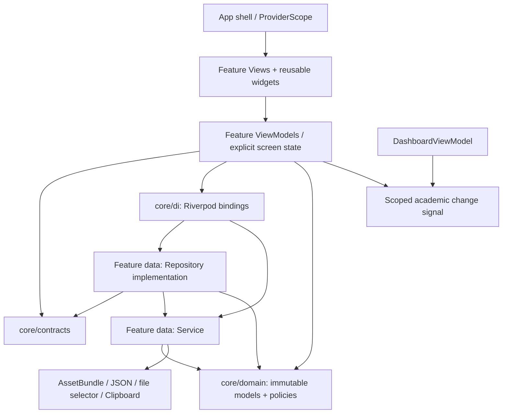

# Kiến trúc Flutter Supervisor — Feature-first + MVVM + Riverpod

Cập nhật: 26/10/2026. Phạm vi: tổ chức lại ứng dụng Supervisor hiện có, giữ hành vi và giao diện; chưa tích hợp Firebase. Không có custom server, không tạo app Web và không thay source React/PoC trong đợt này.

## Căn cứ và mức độ tuân thủ

Đã đọc trực tiếp hai PDF người dùng cung cấp, gồm cả sơ đồ trang 5 Lab 3 và trang 3 Final:

- `D:/PRM393 - Lab 3 Cloud-Enabled Mobile App (Firebase, Patrol, AI Code Review).pdf`: Section 5, trang 4–6. Sơ đồ quy định View hiển thị state/chuyển sự kiện; ViewModel quản lý loading, empty, error, data; các lời gọi nguồn dữ liệu đi qua Service; dependencies chỉ đi xuống. Danh sách thư mục là gợi ý và được thay nếu giải thích lý do.
- `D:/PRM393 - Final Assignment One Complete System on Firebase.pdf`: Section 4 trang 3 và Section 6 trang 4. Hai client dùng cùng Firestore và shared Dart package; áp dụng MVVM cho cả hai; models và Firestore services nằm trong `packages/core/`.

Đây là refactor kiến trúc trên nguồn mô phỏng. Bảng [compliance matrix](evidence/architecture-refactor/compliance-matrix.md) phân biệt rõ phần đã thực hiện, phần được chuẩn bị và phần chưa triển khai; không kết luận ứng dụng đã hoàn tất toàn bộ bài Lab 3/Final.

**Khác biệt giữa hai tài liệu:** Lab 3 yêu cầu Cloud Storage, còn Final Section 4 loại Cloud Storage, Cloud Functions, App Hosting và Cloud Run khỏi phạm vi. Final giữ báo cáo PDF trên thiết bị, chỉ ghi metadata vào Firestore. Đợt này không tích hợp dịch vụ nào, không thêm một backend riêng để hòa trộn hai phạm vi.

## Lý do chọn Feature-first

Cấu trúc theo tầng trước đây trải một luồng học vụ qua `models/`, `viewmodels/`, `repositories/`, `services/`, `screens/`. Feature-first đặt code thay đổi cùng nhau gần nhau, nhưng vẫn giữ ranh giới MVVM ở bên trong từng feature. Đây là thay đổi tổ chức, không thay mô hình nghiệp vụ.

`academic` giữ Course, Semester, Offering, Class, Group, Project, Document, Review và Rule Set trong **một feature học vụ**, vì các lệnh đang lưu cùng snapshot/revision và cập nhật quan hệ trong cùng lần ghi. Chưa chia các entity thành nhiều kho hoặc nhiều ViewModel ghi độc lập: cách chia đó có nguy cơ phá tính nguyên tử, phiên và lịch sử. `dashboard`, `account` và `demo` có phạm vi trình bày/nguồn đọc riêng.

Các đường dẫn import cũ được giữ bằng facade chỉ có `export`; có đúng một bản triển khai của mỗi lớp/provider. Nhờ đó 213 regression tests cũ không cần sửa, và mã sử dụng public API cũ vẫn nhận cùng provider Riverpod. Triển khai mới dùng đường dẫn canonical, không import ngược qua facade cũ.

## Cấu trúc thư mục

```text
lib/
  main.dart
  app/                         # SrsReviewApp, route guard, đăng ký routes; facade công khai cũ
  core/
    domain/                    # Bản ghi bất biến, mô hình, quy tắc thuần Dart
      academic/                # Course/Class/Group/Project/Review, policy, truy vấn và projection
      dashboard/               # Dữ liệu và state trình bày Tổng quan
    contracts/                 # Repository/command/thiết bị; không có SDK
      academic/                # AcademicRepository, Course DTO/command, StudentDeviceGateway
      dashboard/               # DashboardRepository
    di/                        # Ghép concrete Service/Repository bằng Riverpod
    session/                   # SessionViewModel và vòng đời SessionScope theo phiên
    state/                     # ScreenPhase/ScreenState và tín hiệu cập nhật theo ProviderScope
    navigation/                # Điều hướng Flutter dùng chung, không truy cập dữ liệu
  features/
    academic/
      data/repositories/       # FakeAcademicRepository: triển khai contract, truyền phạm vi phiên
      data/services/           # FakeAcademicService, StudentImportService và SDK thiết bị
      presentation/viewmodels/ # Lệnh nghiệp vụ, bản nháp, lọc, trạng thái trang và phép chiếu chỉ đọc
      presentation/views/      # Màn Course/Offering/Class/Semester/Student và widgets riêng
        management/            # View Group/Project/Document/Review trong cùng aggregate học vụ
    dashboard/
      data/repositories/       # FakeDashboardRepository chuyển nguồn đọc thành mô hình
      data/services/           # FakeDashboardService nhận nguồn chung hoặc dữ liệu mẫu
      presentation/viewmodels/ # DashboardViewModel và dữ liệu tóm tắt việc cần làm
      presentation/views/      # Màn Tổng quan và các phần hiển thị
    account/
      data/services/           # NotificationService bao bọc nguồn thông báo mẫu
      data/                    # FakeNotificationRepository triển khai contract
      presentation/viewmodels/ # LoginViewModel, NotificationsViewModel và state màn thông báo
      presentation/views/      # Đăng nhập, hồ sơ, thông báo
    demo/
      data/services/           # Bộ nhớ bộ đếm ví dụ
      data/repositories/       # DemoCounterRepository
      presentation/viewmodels/ # CounterViewModel
      presentation/views/      # Màn ví dụ nền tảng
  theme/                       # ColorScheme, TextTheme, spacing/radius/shadows và token tên rõ ràng
  widgets/                     # Reusable widgets cũ, giữ nguyên thân triển khai
  models/                      # Facade tương thích tới core/domain
  repositories/                # Facade tương thích tới contract và implementation
  services/                    # Facade tương thích tới Service của feature
  viewmodels/                  # Facade tương thích tới ViewModel của feature
  screens/                     # Facade View cũ và màn dự phòng đường dẫn không tồn tại
```

[Migration map](evidence/architecture-refactor/migration-map.md) ghi từng file trước/sau; [migration-plan.json](evidence/architecture-refactor/migration-plan.json) lưu phân loại trước khi di chuyển. Có 76 file được chuyển vị trí qua các nhóm có analyze/tests; 25 file ban đầu giữ vị trí. Các phép chiếu/trạng thái mới được bổ sung mà không tạo store học vụ thứ hai.

## Ranh giới và hướng phụ thuộc

1. View/Widget nhận state và gọi ViewModel. Không import data implementation, DI dữ liệu, `dart:io`, HTTP, Firebase, bộ chọn tệp hay clipboard.
2. Logic lọc, xếp hạng, tổng hợp, validation, xác định quyền thao tác và ghép dữ liệu trình bày nằm ở ViewModel hoặc policy thuần Dart được ViewModel sử dụng.
3. ViewModel phụ thuộc contract/model và provider DI, không phụ thuộc Widget, theme, app shell hay SDK dữ liệu. Không giữ `BuildContext`.
4. Repository contract nằm ở `core/contracts`; concrete Repository thuộc `feature/data` và dùng Service. Không gọi UI/ViewModel từ data.
5. Service bao bọc nguồn dữ liệu/SDK. `AssetBundle`, JSON fixture, `file_selector` và Clipboard chỉ nằm ở data Service hoặc composition DI. Các widget như `SvgPicture`, `QrImageView`, `Canvas` là renderer giao diện, không phải lời gọi SDK dữ liệu.
6. `core/di` là composition module thấp hơn các feature ViewModel: ghép implementation vào contract bằng Riverpod, có thể `overrideWithValue`/`overrideWith` khi kiểm thử. Định nghĩa provider là toàn cục bất biến; trạng thái mutable nằm trong `ProviderScope`, không có store singleton toàn cục.
7. `core/domain` và `core/contracts` chỉ phụ thuộc Dart hoặc lẫn nhau; không import Flutter, Riverpod, theme, session ViewModel hoặc feature.
8. Tín hiệu `academicChangesProvider` chỉ thông báo lần ghi thành công, không giữ dữ liệu. Dashboard theo dõi tín hiệu để tải lại cùng Repository; AcademicViewModel không import DashboardViewModel.
9. Điều hướng, controller nhập liệu/cuộn, khôi phục focus, date/time picker và trạng thái thu gọn nội bộ của reusable widget thuộc tầng trình bày. Chúng không quyết định quyền ghi hay thay đổi dữ liệu. Thẻ chọn, chế độ thư viện, trạng thái đã lưu và bản nháp bộ lọc đã chuyển sang Riverpod ViewModel; lựa chọn lớp tạm trong hộp chọn vẫn là trạng thái UI cục bộ, không phải dữ liệu học vụ chia sẻ.



Các cạnh là phụ thuộc source; dữ liệu/state truyền ngược lên qua giá trị trả về và Riverpod notification, không phải import ngược.

### Loại circular dependencies

- `AcademicSnapshot.dashboardJson`, `ManagementQueries` và `ReviewPolicy` hiện dùng lẫn nhau. Giữ chúng trong một Dart library `academic_models.dart` bằng `part` để bỏ import vòng mà không đổi quy tắc hoặc extension public. Không giả vờ rằng chỉ đổi tên thư mục sẽ giải quyết vòng này.
- `AcademicViewModel`, `ManagementActions`, `ReviewActions` dùng chung một thư viện command bằng `part`; các lệnh vẫn đi qua cùng `mutate`, SessionScope và expectedRevision.
- `SemesterCommands` vẫn ở thư viện `directory_view_model.dart`, không mở rộng export của AcademicViewModel. Điều này giữ tương thích các import cũ trong integration tests.
- Barrel `management_shared.dart` canonical không export ngược `management_form_sheet.dart`; View dùng biểu mẫu import trực tiếp. Facade công khai cũ vẫn export biểu mẫu cho mã ngoài đang dùng đường dẫn cũ.
- Audit import/export/part cuối cùng: xem [dependencies-after.json](evidence/architecture-refactor/dependencies-after.json). Không phát hiện vòng phụ thuộc.

## Trạng thái màn hình

- `AcademicViewModel` giữ `AsyncValue<AcademicSnapshot>` của kho chung. `academicPageProvider(path)` chuyển trạng thái nguồn thành `ScreenState<AcademicSnapshot>` với `ScreenPhase.loading/empty/error/data`, phân loại không tìm thấy entity theo route. Khi empty vẫn giữ snapshot để View dựng đúng nội dung rỗng hiện có; không thay nó bằng một trang trống mới.
- Các danh sách có bộ lọc giữ kết quả `visible`, bản nháp và lỗi ở các ViewModel chuyên biệt. Empty do bộ lọc được hiển thị từ kết quả rỗng, không bị hiểu nhầm thành lỗi nguồn.
- Dashboard giữ `AsyncValue<DashboardState>`; `DashboardState.isEmpty` và các danh sách việc cần làm là trạng thái đầu ra của ViewModel.
- Thông báo dùng `ScreenState<NotificationScreenData>`: ViewModel tính trước bộ lọc, số chưa đọc và nhóm thời gian, giữ thứ tự nguồn. Retry invalidate `notificationsProvider`; public provider này vẫn có thể override qua đường dẫn cũ.
- `AcademicFormState` giữ draft/saving/saveError/saved; lỗi giữ nguyên bản nháp, commit thành công mới công bố đã lưu. Bản nháp bộ lọc chỉ áp dụng khi nhấn xác nhận, đóng bảng không sửa bộ lọc hiện hành.
- Login hiện là thao tác đồng bộ mô phỏng. Validation email/mật khẩu ở LoginViewModel, còn SessionViewModel kiểm tra vai trò và thu hồi scope. Không ghi thêm một trạng thái tải giả khi chưa có xác thực bất đồng bộ.

## Luồng đầy đủ: tạo Course và cập nhật Tổng quan

```mermaid
sequenceDiagram
  actor User as Supervisor
  participant UI as AcademicFormSheet
  participant Form as AcademicFormViewModel
  participant VM as AcademicViewModel
  participant Repo as AcademicRepository / CourseCommandRepository
  participant Service as FakeAcademicService
  participant Signal as academicChangesProvider
  participant Dash as DashboardViewModel
  User->>UI: Nhập mã, tên và nhấn Lưu
  UI->>Form: set(...) / save()
  Form->>Form: Validation; giữ draft, đặt saving
  Form->>VM: saveCourse(draft)
  VM->>VM: CourseDto; phân biệt create/update; requireActive
  VM->>Repo: commitCourse(command, expectedRevision)
  Repo->>Service: commitCourse(command, revision, scope)
  Service->>Service: load; requireActive; kiểm tra ID/mã và revision
  alt Phiên đã đóng hoặc dữ liệu xung đột
    Service-->>Form: AcademicFailure qua Repository/ViewModel
    Form-->>UI: Giữ draft; saveError; cho thử lại
  else Lưu hợp lệ
    Service-->>VM: Snapshot mới, revision + 1
    VM->>VM: Chỉ công bố khi mounted và scope còn active
    VM->>Signal: committed()
    Signal-->>Dash: Riverpod notification
    Dash->>Repo: Tải lại cùng nguồn học vụ qua binding Dashboard
    Repo-->>Dash: Snapshot nguồn chung
    Dash->>Dash: Tính thống kê, giữ học kỳ trong cùng phiên
    Form-->>UI: saved; đóng biểu mẫu nếu phiên còn hiệu lực
  end
```

Nguồn chung được giữ trong FakeAcademicService theo ProviderScope. Kết thúc phiên không xóa dữ liệu đã commit trong kho mô phỏng, nhưng thu hồi quyền của tác vụ đang chờ. Đây là hành vi cũ được giữ nguyên, không phải bằng chứng về persistence hoặc đồng bộ Firebase.

## ViewModel và Repository/Service sử dụng

| ViewModel / state producer | Repository/Service qua DI | Trách nhiệm |
| --- | --- | --- |
| SessionViewModel | Chưa có auth Service; phiên mô phỏng | Vai trò Supervisor, generation, đóng SessionScope đồng bộ |
| LoginViewModel | SessionViewModel | Validation giữ nguyên thông báo, gửi thao tác đăng nhập |
| NotificationsViewModel + notificationScreenProvider | NotificationRepository → FakeNotificationRepository → NotificationService | Tải/thử lại, thẻ lọc, unread, nhóm thời gian, trạng thái rõ ràng |
| AcademicViewModel + command parts | AcademicRepository / CourseCommandRepository → FakeAcademicRepository → FakeAcademicService | Lệnh học vụ nguyên tử, revision, chống gửi lặp, phiên và lịch sử |
| AcademicPageViewModel/provider | Quan sát AcademicViewModel | Loading/empty/error/data theo đường dẫn |
| AcademicPresentationViewModel | Nhận snapshot đã tải, không có nguồn I/O riêng | Phép chiếu quan hệ, quyền thao tác, lọc và tổng hợp phục vụ View |
| AcademicFormViewModel | AcademicViewModel | Draft, schema trường, validation, saving/error/saved |
| ManagementFormViewModel | AcademicViewModel và SemesterCommands | Bản nháp nhóm/dự án/phản hồi/quyết định, giữ lỗi để thử lại |
| ManagementListViewModel | Snapshot từ AcademicViewModel | Tìm kiếm, AND/OR, điều kiện cha–con, khoảng thời gian và sắp xếp |
| ClassFilterViewModel | Snapshot từ AcademicViewModel | Lọc lớp, tùy chọn môn, chế độ xem trong phiên |
| StudentDirectoryViewModel | Snapshot từ AcademicViewModel | Lọc danh bạ và số sinh viên có nhóm |
| StudentEnrollmentViewModel | AcademicViewModel; StudentDeviceGateway → StudentImportService | CSV/đọc mẫu XLSX, chọn danh bạ, ghi danh batch, sao chép, QR |
| ReviewPanelViewModel + AiPanelPresentation | AcademicViewModel / ReviewActions | Chạy AI minh họa, thử lại, phát hiện thành phản hồi nháp, phép chiếu điểm |
| DocumentReaderViewModel + DocumentSampleData | Snapshot đã tải, không đọc tệp thật | Trang, vị trí cuộn và chia nội dung mẫu |
| AcademicUiViewModel | Không I/O; phụ thuộc SessionScope | Thẻ màn hình, thư viện Rule Set |
| FilterDraftViewModel | Không I/O; phụ thuộc SessionScope | Bản nháp bộ lọc theo từng lần mở |
| DashboardViewModel + DashboardTaskPresentation | DashboardRepository → FakeDashboardRepository → FakeDashboardService | Tải, học kỳ, thống kê và danh sách tóm tắt |
| CounterViewModel | CounterRepository → DemoCounterRepository → DemoCounterService | Ví dụ nền tảng, không tham gia nghiệp vụ SRS |

Mọi external I/O đi qua Service. Các ViewModel chỉ đọc/phép chiếu nhận dữ liệu đã được ViewModel nguồn tải, không mở thêm Repository để tạo bản dữ liệu cạnh tranh.

## Những bất biến được giữ

- Course identity: create/update tách biệt; CourseDto chuẩn hóa mã và giữ trường dữ liệu cũ; không chuyển create thành upsert khi trùng ID.
- Group/Project: các lệnh vẫn cập nhật hai chiều liên kết và thành viên; trưởng nhóm là thành viên đầu tiên; lớp có dữ liệu không bị xóa dở dang.
- Review: ruleSnapshot và phiên bản cũ giữ nguyên; chỉ phản hồi được chọn đúng yêu cầu/phiên bản được công bố; AI không chuyển tài liệu thành approved.
- Revision/session: kiểm tra trước commit, chặn double-submit, bỏ cập nhật sau dispose/đăng xuất; UI state mới không giữ một service hoặc kho dữ liệu toàn cục.
- FakeAcademicService: không sửa thân khai báo, xác minh token giống baseline; giữ load deduplication, snapshot trong bộ nhớ, conflict, Course validation và tăng revision.
- Design system: toàn bộ khai báo theme cũ và reusable widgets cũ giữ token như baseline. Thêm `AppFeatureMetrics` để đặt tên cho các kích thước đặc thù đang có ở màn login/profile/tài liệu mẫu, giữ nguyên giá trị số và bố cục.

## Chuẩn bị packages/core cho Final

Hiện **chưa tạo shared package thực sự** và chưa có Firestore services. Phần đã chuẩn bị là ranh giới source có thể chuyển package mà không kéo theo Widget/ViewModel:

| Hiện tại | Vị trí dự kiến trong Final | Lưu ý |
| --- | --- | --- |
| core/domain | packages/core/lib/src/domain | Thuần Dart, không Flutter/Riverpod/SDK; giữ model/policy và ID dùng chung |
| core/contracts | packages/core/lib/src/contracts | Repository/command contract; không truyền BuildContext hoặc Widget |
| Feature data adapters mới cho Firestore | packages/core/lib/src/services/firestore | Chỉ tạo khi chốt schema và Security Rules; không chuyển FakeAcademicService thành nguồn production |
| theme và reusable widgets | packages/core/lib/src/design_system | Module có phụ thuộc Flutter; giữ chung token/component cho hai client |
| Feature ViewModels/Views và core/session/core/di | mobile hoặc web tương ứng | Mỗi client tự composition DI, state UI và policy truy cập vai trò |

Trình tự chuyển sau này: chốt data-model/status transitions → đóng gói domain/contracts → thêm typed codec và Firestore service dùng transaction theo aggregate → kiểm tra UID/role qua Security Rules và App Check → hai client cùng dùng package → chạy lại regression và Emulator rules tests. Không có nhánh gọi Cloud Functions/custom server trong thiết kế Final.

Schema snapshot hiện còn giữ payload fixture/legacy và phép chiếu minh họa. Nó chưa phải collection schema Firestore. Không upload toàn snapshot này lên Firestore như một tài liệu để giả lập migration hoàn tất. Course DTO hiện chỉ là phần đầu tiên; các aggregate khác cần schema/contract migration riêng có kiểm thử.

## Phần chưa tách sâu và giới hạn xác nhận

- Giữ một aggregate ghi học vụ và command library; chưa tách Course/Group/Project/Review thành các store độc lập vì nguy cơ phá revision, liên kết và lịch sử.
- Giữ vòng đời ScrollController/TextEditingController, Canvas và cơ chế focus trong View/reusable widget để tránh đổi hành vi nhập liệu và đọc toàn màn hình. Đây là logic trình bày, không I/O hoặc nghiệp vụ.
- Giữ codec legacy, mô hình bản nộp và AI minh họa. Chưa xác nhận format dữ liệu server, phân công theo UID hay real-time listener vì chưa có Firebase trong phạm vi.
- 76 facade cũ được giữ để bảo toàn public import API; không nhân bản triển khai. Không xóa chúng chỉ để làm đẹp cây thư mục.
- Unit/widget tests chạy trên host, gồm các màn ở 360/390/412 dp như suite hiện hữu. Không chạy ARTEMIS/Patrol hoặc demo thiết bị thật trong task này; không kết luận toàn bộ accessibility của handoff đạt chỉ từ một audit source.
- Không dùng kết quả refactor để tuyên bố đã đạt những yêu cầu Firebase, Security Rules, App Check, instrumentation, shared-package hai client hay E2E triển khai của Final.

## Kiểm chứng và bằng chứng

16/16 phần khai báo domain/command trọng yếu giữ nguyên token, gồm models, policy, Course command, Group/Project commands, Review commands và SessionScope; xem [business-preservation.json](evidence/architecture-refactor/business-preservation.json).

Báo cáo thực thi tại [README evidence](evidence/architecture-refactor/README.md), gồm baseline, từng nhóm analyze/tests, suite cuối và kiểm tra hash tests cũ. Audit source chỉ là kiểm tra cấu trúc import/AST; không phải chứng minh hình thức rằng không còn mọi loại nghiệp vụ trong UI. Đã đọc thủ công các phép chiếu trước/sau và chạy lại regression để bảo vệ hành vi.

Không sửa/xóa/skip 213 tests ban đầu, không thay dependency, Firebase config, source React/PoC, không commit/push. 7 tests mới chỉ bổ sung kiểm tra trạng thái và phạm vi cập nhật.
