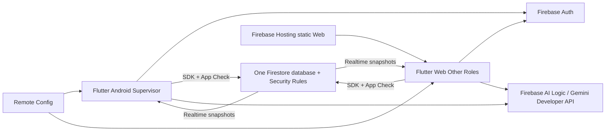

# Google AI Studio + Firebase serverless: kết quả nghiên cứu

Ngày xác minh: **26/10/2026, Asia/Saigon**. Phạm vi: tài liệu công khai chính thức Google, Firebase, Flutter và hai PDF PRM393 trong workspace. Chưa thử tính năng bằng tài khoản AI Studio/Firebase; “được tài liệu hỗ trợ” không đồng nghĩa đã chạy thành công trong tài khoản nhóm.

## 1. Kết luận cho SRS Review AI

**Chọn Flutter hiện tại + Firebase SDK + Firebase AI Logic làm hướng tích hợp chính.** Flutter Android Supervisor và Flutter Web của thành viên khác có thể đăng ký thành hai Firebase Apps trong **một Firebase project**, dùng chung Authentication và cùng Firestore database. Không cần AI Studio làm cầu nối dữ liệu hay custom server. Firebase AI Logic có SDK Dart/Flutter chính thức. [Firebase projects](https://firebase.google.com/docs/projects/learn-more), [Flutter setup](https://firebase.google.com/docs/flutter/setup), [AI Logic get started](https://firebase.google.com/docs/ai-logic/get-started).

AI Studio Build Mode đã hỗ trợ GitHub import/two-way sync trong tài liệu tổng quan, full-stack Web và Android native. Tuy nhiên Web mặc định là React + Node.js, deploy Cloud Run; Android là **Kotlin + Jetpack Compose**, không phải Flutter. Trang Android còn ghi chỉ xuất ZIP, chưa có GitHub export. Không đủ căn cứ để đưa repo Flutter chính vào Build Mode và kỳ vọng giữ nguyên MVVM, Dart package và 213 regression tests. [Build Mode](https://ai.google.dev/gemini-api/docs/aistudio-build-mode), [Android](https://ai.google.dev/gemini-api/docs/aistudio-android).

Final p.3 và **sơ đồ p.3** loại Cloud Functions, Cloud Storage, App Hosting **và Cloud Run**; p.5 yêu cầu Gemini qua Firebase AI Logic. Vì vậy workflow Build Web mặc định chưa phù hợp bản nộp. AI Studio vẫn hữu ích để thử prompt, JSON schema và prototype tách biệt. Chi tiết chấm yêu cầu nằm trong [so sánh workflow](workflow-comparison.md); kế hoạch chứng minh đồng bộ nằm trong [PoC](firebase-poc-plan.md).

## 2. Cách nghiên cứu và trạng thái bằng chứng

- Dùng Exa Search: 36 kết quả qua 7 truy vấn, sau đó đọc trực tiếp các trang liên quan. Chỉ dùng nguồn Google/Firebase/Flutter để kết luận tính năng; không lấy bài bên thứ ba làm bằng chứng.
- Đối chiếu trực tiếp Lab 3 và Final PDF, gồm hình kiến trúc Final p.3; đối chiếu báo cáo Phase 5.0, contracts và manifest local.
- **FACT**: được nguồn chính thức mô tả. **ASSESSMENT**: đánh giá áp dụng vào SRS Review AI. **NOT VERIFIED**: cần tài khoản, bản build hoặc quyết định nhóm để kiểm tra.
- Mọi nguồn Web dưới đây được truy cập **26/10/2026**; chỉ ghi ngày cập nhật trang khi trang trả rõ. Tính năng rollout, quota, giá và model cần kiểm tra lại trước thực thi.
- Chỉ tạo ba tài liệu nghiên cứu. Không tạo cloud project, bật billing, import repo, sửa Mobile/React, chạy PoC, commit hoặc push.

Baseline local: [mobile-test-coverage.md](../mobile-test-coverage.md) ghi 213/213 unit/widget tests PASS, Firebase/emulator/ARTEMIS chưa chạy. `pubspec.yaml` hiện chưa có Firebase plugins. Đây là baseline được báo cáo trước, **không phải kết quả chạy test mới của nghiên cứu này**. Web Flutter do thành viên khác phụ trách; thư mục `D:/UI AI Review` là nguồn React tham chiếu, không chứng minh Flutter Web hiện đã hoàn thành.

## 3. AI Studio thực sự hỗ trợ gì?

| Câu hỏi | Kết quả xác minh | Giới hạn áp dụng |
|---|---|---|
| Import GitHub? | **Có**: Build Mode, Add files (+) → Import from GitHub; Settings → GitHub liên kết repo | Không còn chính xác nếu nói “AI Studio chỉ export, không import”. Không kiểm tra quyền/private repo/monorepo thực tế của nhóm. [Build](https://ai.google.dev/gemini-api/docs/aistudio-build-mode) |
| Đồng bộ GitHub? | Tổng quan mô tả push/pull hai chiều và giải quyết conflict | Trang Android chuyên biệt ghi **ZIP only, GitHub export not yet available**. Áp dụng thận trọng: workflow Web có tài liệu hỗ trợ; chưa cam kết parity Android hoặc Flutter. [Build](https://ai.google.dev/gemini-api/docs/aistudio-build-mode), [Android limitations](https://ai.google.dev/gemini-api/docs/aistudio-android) |
| Tạo ứng dụng Web? | Có frontend React mặc định và Node.js server runtime; npm, secrets, database connections | Không đồng nghĩa Flutter Web; chuyển framework cần kiểm chứng riêng. [Build](https://ai.google.dev/gemini-api/docs/aistudio-build-mode) |
| Tạo Android? | Có project Gradle, Kotlin, Jetpack Compose, browser emulator, cài máy thật qua WebUSB, internal testing Play | Không phải Dart/Flutter; Android hiện chỉ single-activity/single-module, Compose, không Java/XML/NDK. Emulator cloud không có Google Play services; Google Sign-In cần máy thật theo tài liệu. [Android](https://ai.google.dev/gemini-api/docs/aistudio-android) |
| Build/import Flutter end-to-end? | **Chưa có bảo đảm trong các tài liệu đã đọc** | Import được source không chứng minh có Flutter toolchain, preview, build APK hay giữ kiến trúc hiện hữu. Không kết luận “không bao giờ hỗ trợ Flutter”. |
| Kết nối Firebase? | Agent có thể provision Firestore, Auth, rules cho Web/Android; Android AI thêm AI Logic + App Check | Đây là thao tác tạo/cấu hình tài nguyên thật sau Enable Firebase, không chỉ sinh code. [Integration](https://firebase.google.com/docs/ai-assistance/ai-studio-integration) |
| Gemini khi app chạy? | Web mặc định: Google Gen AI SDK ở server, `GEMINI_API_KEY` trong secrets; Android: Firebase AI Logic + App Check | Gemini dùng để sinh code trong editor và Gemini mà người dùng gọi lúc runtime là hai việc khác nhau. App sinh bởi AI không tự đáp ứng tiêu chí AI của Final. [Build](https://ai.google.dev/gemini-api/docs/aistudio-build-mode), [Integration](https://firebase.google.com/docs/ai-assistance/ai-studio-integration) |
| Deploy? | Web publish Cloud Run; Android cài thiết bị hoặc Play internal test | Cloud Run khác Firebase Hosting; mobile web/responsive không thay APK Flutter. [Deploying](https://ai.google.dev/gemini-api/docs/aistudio-deploying), [Android](https://ai.google.dev/gemini-api/docs/aistudio-android) |

**Xử lý tài liệu chưa đồng nhất:** trang Build vẫn có FAQ nói đang làm direct storage support, trong khi phần capabilities và trang Firebase chuyên biệt đã mô tả tích hợp Firestore. Dùng trang Firebase chuyên biệt để xác định integration; ghi riêng hạn chế thay vì suy từ FAQ cũ. Với GitHub Android, giữ hạn chế trang Android chuyên biệt cho đến khi thử được ở sandbox. Chưa thử UI nên không khẳng định mọi tài khoản thấy các nút giống nhau.

## 4. Kết nối Firebase bằng AI Studio có những hệ quả gì?

Theo [Firebase AI Studio integration](https://firebase.google.com/docs/ai-assistance/ai-studio-integration):

1. Prompt yêu cầu database/auth/AI → agent đưa setup card → có thể chọn project/location → Enable Firebase.
2. Web có thể được tạo `src/lib/firebase.ts`, `firestore.rules`; Android có `google-services.json`, `firestore.rules`, `firebase_applet_config.xml`.
3. Có thể chọn existing Google Cloud project mình sở hữu. Nhưng tài liệu ghi **nếu Firebase project đã có Firestore database thì agent không thêm được database nữa**, cần project khác/rỗng. Đây là hạn chế integration, không phải giới hạn chung của Firebase SDK.
4. Agent cấp quyền cho `ais-sandbox@PROJECT_ID.iam.gservice.com`; agent có quyền quản trị dữ liệu. Cần review IAM và khả năng sửa/xóa dữ liệu trước bất kỳ thử nghiệm sau này.
5. Location đã chọn cho resources do AI Studio thiết lập không đổi được theo workflow này. Ghi rõ project ID, database ID và location; không mặc định app dùng `(default)`.
6. Rules sinh bởi AI phải review/test. Chỉnh rules riêng trong console có thể bị agent ghi đè ở iteration sau. Backend cần một nguồn rules chuẩn và một quy trình deploy thống nhất.
7. Firebase Android integration/AI Logic + App Check có ghi chú rollout; tính khả dụng theo tài khoản **chưa xác minh**.

AI Studio Android tự quản debug App Check token, và tài liệu ghi release dùng reCAPTCHA Enterprise. Đây là cơ chế riêng của Android được AI Studio sinh ra; **không chép thành mặc định Flutter Android**. Flutter App Check có tài liệu riêng: Play Integrity cho Android, reCAPTCHA cho Web, debug provider cho môi trường phát triển. [Android](https://ai.google.dev/gemini-api/docs/aistudio-android), [Flutter App Check](https://firebase.google.com/docs/app-check/flutter/default-providers).

## 5. Phân biệt ba nền tảng

| Mục | React Web trong AI Studio | Android native trong AI Studio | Flutter Android + Flutter Web |
|---|---|---|---|
| Ngôn ngữ/UI | JS/TS, React mặc định | Kotlin, Jetpack Compose | Dart, Flutter widgets |
| Runtime | Browser + Node server | Android client | Android client / browser client |
| Gemini mặc định của workflow | Google Gen AI SDK trên server | Firebase AI Logic + App Check | Tích hợp `firebase_ai` + App Check qua service |
| Backend dữ liệu | Firebase integration hoặc network backend | Firestore/Auth qua integration | `firebase_core`, `firebase_auth`, `cloud_firestore` |
| Triển khai | AI Studio Publish → Cloud Run | APK/Play internal testing | APK Android; static Web release trên Firebase Hosting |
| Chia sẻ `packages/core` Dart | Không dùng trực tiếp như Dart package | Không dùng trực tiếp | Có thể dùng models/services và phần Flutter theme/widgets phù hợp |
| MVVM của dự án hiện tại | Cần thiết kế lại/đối chiếu | Có ViewModels native nhưng không tái sử dụng Dart MVVM | Giữ View → VM → repository → service/SDK, tích hợp từng adapter |

Nguồn: [Build](https://ai.google.dev/gemini-api/docs/aistudio-build-mode), [Android](https://ai.google.dev/gemini-api/docs/aistudio-android), [FlutterFire](https://firebase.google.com/docs/flutter/setup), [Flutter MVVM](https://docs.flutter.dev/app-architecture/guide), [Firebase Hosting](https://firebase.google.com/docs/hosting).

## 6. Một Firebase project cho Web và Mobile

**FACT: được hỗ trợ chính thức.** Firebase project chứa nhiều registrations Android/Web; cùng project chia sẻ backend Authentication, Firestore và các tài nguyên tương ứng. `appId` khác nhau theo platform; `projectId` chung. Dữ liệu chỉ đồng bộ khi hai client trỏ **cùng database ID, collection/path và môi trường**, có quyền đọc và dùng realtime listeners. Đăng nhập cùng project không có nghĩa mọi role được đọc mọi dữ liệu. [Projects](https://firebase.google.com/docs/projects/learn-more), [Listeners](https://firebase.google.com/docs/firestore/query-data/listen).

Thiết kế dự kiến:

AI có thể chỉ được gọi từ một client nếu đủ nghiệp vụ Final; sơ đồ thể hiện khả năng, không bắt cả hai gọi. Analytics và Remote Config cần ở cả hai; Crashlytics ở Mobile theo Final.

Các điều kiện nhóm phải thiết lập ở phase sau:

- Backend quản lý một project cho môi trường demo; dev/prod nên tách project khi có nhu cầu, tránh seed/test lên dữ liệu thật. Android/Web registrations trong từng môi trường vẫn dùng chung backend.
- Chạy FlutterFire configure cho đúng platform/project trong PoC riêng. Nếu hai client ở hai repo thì mỗi repo có options đúng app; không copy nguyên options Android sang Web.
- Android: package ID, SHA signing fingerprints phù hợp Google Sign-In; Web: domain được phép cho Auth, cấu hình Google provider. Không dùng mock UID trong cloud demo.
- Rules đọc `users/{uid}.role` và assignment; chỉ Admin đổi role, không tự cấp `supervisor` qua form. Auth nhận diện người dùng; App Check xác minh app; rules quyết định quyền dữ liệu. [Rules/Auth](https://firebase.google.com/docs/rules/rules-and-auth), [App Check](https://firebase.google.com/docs/app-check/flutter/default-providers).
- Đăng ký App Check cho cả Android và Web trước enforcement Firestore; AI Logic setup hiện có thể tự enforce App Check từ workflow mới. Debug token chỉ ở test được quản lý. [AI Logic setup](https://firebase.google.com/docs/ai-logic/get-started).
- Stream qua service/repository → VM, hủy khi logout/đổi scope. Snippet Firebase đặt SDK trong widget chỉ là minh họa API, không phù hợp quy tắc MVVM Lab 3. [Flutter architecture](https://docs.flutter.dev/app-architecture/guide).
- Persistent cache mặc định Android và Web khác nhau; cache/pending local write không phải bằng chứng sync server. Transactions thất bại khi offline, nên quyết định review phải có trạng thái lỗi/retry rõ. [Offline](https://firebase.google.com/docs/firestore/manage-data/enable-offline), [Transactions](https://firebase.google.com/docs/firestore/manage-data/transactions).

## 7. Gemini đúng yêu cầu Final

Hướng B dùng `firebase_ai` qua service được inject; backend chọn Gemini Developer API theo Final, không tự thay bằng provider khác. AI Studio dùng thử prompt là tùy chọn, **không phải dependency runtime**. [Dart setup](https://firebase.google.com/docs/ai-logic/get-started).

Đề xuất Level 2: góp ý tiêu chí SRS từ đoạn học thuật đã loại PII, trả JSON → model Dart typed: version tài liệu, criterion ID, severity enum, finding, suggested edit. Dùng `application/json` và response schema, rồi validate lại giá trị/ID/range/độ dài trong app; JSON đúng cú pháp chưa bảo đảm nhận xét đúng. Hiển thị nhãn AI, cho sửa/chọn/accept; không tự approve review. [Structured output](https://firebase.google.com/docs/ai-logic/generate-structured-output).

Remote Config quản `ai_enabled`, `ai_model`, `ai_prompt_template`, kèm defaults an toàn và config version. Pin model khả dụng thực tế khi triển khai, không đóng cứng tên model từ tutorial cũ. Final cần `ai_request`, `ai_result_accepted`, `ai_error`, ba real input/output và một failure. Không log prompt/nội dung SRS/PII vào Analytics/Crashlytics. Schema, timeout/quota/fallback và policy `aiRequiredBeforeSupervisor` cần nhóm chốt; client có thể giả mạo AI result nên không coi trường `aiCompleted` do client ghi là bằng chứng tin cậy rằng Gemini đã chạy.

## 8. Figma → Stitch → GitHub → AI Studio: mũi tên nào đã được chứng minh?

| Chặng | Có bằng chứng gì? | Cách áp dụng nghiên cứu |
|---|---|---|
| Figma → Stitch | Google mô tả input ảnh/wireframe, code/design context; bài gốc nêu **Stitch → paste to Figma** | Không tự đảo chiều thành import nguyên Figma file/prototype có semantics. Sau này thử ảnh export đã duyệt + DESIGN.md ở sandbox, đo mất tokens/states/flow |
| Stitch → code/AI Studio | Bài Google 18/03/2026 nêu exports tới AI Studio/Antigravity, MCP/SDK và DESIGN.md | Có đường handoff; không chứng minh output Flutter, MVVM, rules hoặc testing tự hoàn thiện |
| Stitch → GitHub | Nguồn đã đọc không đủ chứng minh một click GitHub sync đầy đủ | GitHub có thể là bước nhóm lưu/review source export bằng workflow thông thường; nút/export trực tiếp cần thử riêng |
| GitHub → AI Studio | Build docs xác nhận import và sync | Chỉ dự kiến thử repository mẫu sạch; không import project chính |
| AI Studio → Firebase → demo | Integration và publish có tài liệu | Tạo tài nguyên thật/IAM/rules/billing; Web default Cloud Run không phù hợp Final |

Nguồn: [Stitch ban đầu](https://developers.googleblog.com/stitch-a-new-way-to-design-uis/), [Stitch 2026](https://blog.google/innovation-and-ai/models-and-research/google-labs/stitch-ai-ui-design/), [DESIGN.md](https://blog.google/innovation-and-ai/models-and-research/google-labs/stitch-design-md/), [Build](https://ai.google.dev/gemini-api/docs/aistudio-build-mode). Lead có thể giữ chuỗi này để minh họa công cụ; không nên coi nó là pipeline chuyển đổi Flutter tự động đã kiểm chứng.

## 9. Chi phí và rủi ro đã xác minh

| Hạng mục | Kết quả / hệ quả |
|---|---|
| AI Studio Publish | Eligible Starter Tier cho tối đa 2 apps không cần billing setup; vẫn chạy Cloud Run. Workspace/Education accounts và tài khoản có billing history có thể không đủ điều kiện. Standard deployment cần billing. Không khẳng định mọi demo AI Studio đều miễn phí hoặc đều phải trả phí. [Deployment](https://ai.google.dev/gemini-api/docs/aistudio-deploying) |
| Firebase AI Logic | Bản thân dịch vụ không thu phí; Gemini tính theo model/tier/features. Free tier dùng Spark khi không link billing; link billing thì Gemini Developer API usage theo paid pricing, dù Firestore còn mức miễn phí riêng. Có thể cần prepayment. [Pricing](https://firebase.google.com/docs/ai-logic/pricing), [Gemini billing](https://ai.google.dev/gemini-api/docs/billing) |
| Firestore tiêu chuẩn | Free quota: 1 GiB, 50.000 reads/ngày, 20.000 writes/ngày, 20.000 deletes/ngày, 10 GiB outbound/tháng; một free database/project. Listener/reconnect/rules reads có thể làm tăng usage. [Quotas](https://firebase.google.com/docs/firestore/quotas) |
| Firestore do AI Studio tạo | Nhóm AI shared quota riêng: tổng 1 GiB, 50.000 read units/ngày, 40.000 write units/ngày, 50.000 realtime update units/ngày, 10 GiB egress/tháng. Không dùng bảng này để dự toán Firestore tiêu chuẩn của B. Linking billing chưa tự bỏ shared cap; upgrade database là bước riêng. [Integration quotas](https://firebase.google.com/docs/ai-assistance/ai-studio-integration) |
| Lab 3 Cloud Storage | Tài liệu Firebase hiện yêu cầu Blaze cho Storage; no-cost usage có thể tồn tại trên Blaze, nhưng không phải Spark. Mâu thuẫn với ghi chú Spark đủ trong đề Lab 3 phải hỏi giảng viên. Final cấm Storage nên PoC B không cần dịch vụ này. [Storage billing FAQ](https://firebase.google.com/docs/storage/faqs-storage-changes-announced-sept-2024) |
| Budget | Firestore budget alerts không tự chặn usage. Nếu được phép Blaze, cần owner/budget, quota và Gemini spend caps nơi được hỗ trợ; không coi mọi alert là hard cap. [Firestore limits](https://firebase.google.com/docs/firestore/quotas), [AI pricing](https://firebase.google.com/docs/ai-logic/pricing) |
| Dữ liệu và secrets | Chỉ dùng SRS giả lập/đã khử PII cho thử prompt; không upload repo, tài liệu học viên hoặc service-account secrets vào môi trường sinh code. Firebase config công khai khác raw Gemini key: Gemini key không đưa vào Flutter/browser. [Project config](https://firebase.google.com/docs/projects/learn-more), [Integration key guidance](https://firebase.google.com/docs/ai-assistance/ai-studio-integration) |

Không báo một con số USD cố định khi chưa chốt model, số token, region, tier và traffic. PoC sync emulator dự kiến không phát sinh cloud usage; demo Spark chỉ hướng tới $0 trong quota, không phải bảo đảm mọi tính năng miễn phí. Cách giới hạn và tính dự toán nằm trong [PoC §8](firebase-poc-plan.md#8-chi-phí-giới-hạn-và-rủi-ro).

## 10. Danh mục nguồn chính thức

Tất cả xác minh **26/10/2026**. Các ngày “updated” là metadata trang, không phải ngày chạy thử.

| ID | Tài liệu | Ngày trang nếu đã thấy | Dùng để xác minh |
|---|---|---|---|
| G01 | [AI Studio Build Mode](https://ai.google.dev/gemini-api/docs/aistudio-build-mode) | 20/10/2026 UTC | GitHub import/sync, React/Node, Gemini secrets |
| G02 | [AI Studio Android](https://ai.google.dev/gemini-api/docs/aistudio-android) | 20/10/2026 UTC | Kotlin/Compose, emulator, ZIP/GitHub limitation |
| G03 | [AI Studio deployment](https://ai.google.dev/gemini-api/docs/aistudio-deploying) | Không dùng ngày cập nhật làm kết luận | Cloud Run, Starter eligibility, billing |
| F01 | [Firebase AI Studio integration](https://firebase.google.com/docs/ai-assistance/ai-studio-integration) | 20/10/2026 UTC | Firebase setup, IAM, rollout, existing project, shared quota |
| F02 | [Understand Firebase projects](https://firebase.google.com/docs/projects/learn-more) | 21/10/2026 UTC | Multi-app/shared backend/config |
| F03 | [Add Firebase to Flutter](https://firebase.google.com/docs/flutter/setup) | 23/10/2026 UTC | FlutterFire và platform plugin support |
| F04 | [AI Logic get started](https://firebase.google.com/docs/ai-logic/get-started) | Không ghi nhận footer đầy đủ | `firebase_ai`, Dart, provider, App Check |
| F05 | [AI Logic structured output](https://firebase.google.com/docs/ai-logic/generate-structured-output) | Không ghi nhận footer đầy đủ | JSON/schema/Dart |
| F06 | [AI Logic pricing](https://firebase.google.com/docs/ai-logic/pricing) | Không ghi nhận footer đầy đủ | Spark/Blaze, Gemini costs |
| F07 | [Flutter App Check](https://firebase.google.com/docs/app-check/flutter/default-providers) | Không ghi nhận footer đầy đủ | Providers/debug/enforcement |
| F08 | [Firestore listeners](https://firebase.google.com/docs/firestore/query-data/listen) | Không ghi nhận footer đầy đủ | Realtime streams/metadata |
| F09 | [Firestore offline](https://firebase.google.com/docs/firestore/manage-data/enable-offline) | Không ghi nhận footer đầy đủ | Platform cache defaults, sync/conflicts |
| F10 | [Firestore transactions](https://firebase.google.com/docs/firestore/manage-data/transactions) | Không ghi nhận footer đầy đủ | Atomicity/retry/offline failure |
| F11 | [Firestore emulator](https://firebase.google.com/docs/emulator-suite/connect_firestore) | Không ghi nhận footer đầy đủ | Demo project/local connection |
| F12 | [Rules unit tests](https://firebase.google.com/docs/rules/unit-tests) | Không ghi nhận footer đầy đủ | v9 testing API/auth contexts; chỉ dùng phần API hiện hành, không copy ví dụ v8 lịch sử |
| F13 | [Firestore quotas](https://firebase.google.com/docs/firestore/quotas) | 23/10/2026 UTC | Standard quota, limits, budget alerts |
| F14 | [Storage billing changes](https://firebase.google.com/docs/storage/faqs-storage-changes-announced-sept-2024) | Không ghi nhận footer đầy đủ | Storage yêu cầu Blaze |
| F15 | [Firebase Hosting](https://firebase.google.com/docs/hosting) | Không ghi nhận footer đầy đủ | Static SPA/CDN, khác Cloud Run |
| F16 | [Rules and Authentication](https://firebase.google.com/docs/rules/rules-and-auth) | 20/10/2026 UTC | Identity/role authorization |
| D01 | [Flutter architecture guide](https://docs.flutter.dev/app-architecture/guide) | Không dùng search date làm ngày cập nhật | Views/VM/repositories/services |
| D02 | [Architecture recommendations](https://docs.flutter.dev/app-architecture/recommendations) | Không dùng search date làm ngày cập nhật | DI/fakes/layer tests |
| D03 | [Flutter Web deployment](https://docs.flutter.dev/deployment/web) | Không ghi nhận footer đầy đủ | Web release và Hosting |
| S01 | [Stitch introduction](https://developers.googleblog.com/stitch-a-new-way-to-design-uis/) | Công bố 20/05/2025 | Images/wireframes, code export, paste to Figma |
| S02 | [Stitch design canvas](https://blog.google/innovation-and-ai/models-and-research/google-labs/stitch-ai-ui-design/) | Công bố 18/03/2026 | DESIGN.md, MCP/SDK, AI Studio exports |
| S03 | [Stitch DESIGN.md](https://blog.google/innovation-and-ai/models-and-research/google-labs/stitch-design-md/) | Công bố 21/04/2026 | Portable design rules; không phải business backend |
| G04 | [Gemini billing](https://ai.google.dev/gemini-api/docs/billing) | Không ghi nhận footer đầy đủ | Paid/free separation, setup/prepayment |

Các PDF môn học là nguồn yêu cầu độc lập, không thay bằng tài liệu vendor. Đường dẫn và trang đối chiếu nằm trong [workflow comparison](workflow-comparison.md).
